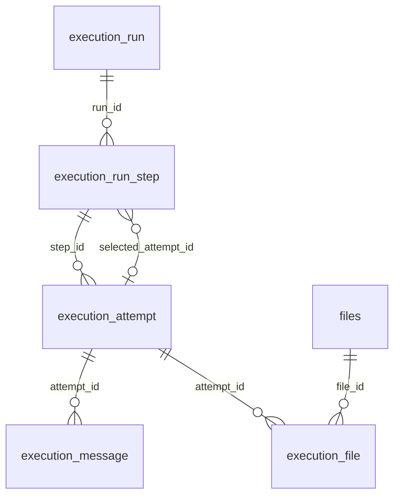

import ExecutionAnimation from '@site/src/components/ExecutionAnimation';

Training, analysis, import Tools, and tests share this model. **Global** is the Platform API; **Local** is the Client API; **Orch API** manages Docker containers.

## Run → step → attempt

| Object | Owns |
| --- | --- |
| Run | One execution: purpose, mode, location, and ordered steps. |
| Step | One workflow node or standalone Tool/model, inputs, parameter search, and selected attempt. |
| Attempt | One parameter trial or federated participant execution, with its own status, messages, and outputs. |

`purpose` selects the feature; `mode` is `SINGLE` or `FEDERATED`; `location` is `LOCAL` or `PLATFORM`.
`SINGLE` means one participant; its workflow may still contain several steps. A standalone Tool/model uses one step without a workflow node.

<ExecutionAnimation />

## Run types

- [Central training](central-training.md)
- [Federated training](federated-training.md)
- [Analysis](analysis.md)
- [Processing](processing.md)
- [Tool tests](tool-tests.md)
- [Hosted engine](hosted-engine.md)

## ORM and storage

Platform (Global API) and Site (Local API) each write their **own PostgreSQL database**. Common mappings exist in both; extension rows name their owning database. Core `Base*Entity` classes supply inherited fields through `@MappedSuperclass`; only concrete entities have tables. See [Quarkus Hibernate ORM/Panache](https://quarkus.io/guides/hibernate-orm-panache/).

Edge labels name foreign-key columns. A step selects at most one attempt. Every attempt keeps its own messages and file links.

| Entity | Stores |
| --- | --- |
| `ExecutionRunEntity` | Purpose/mode/location and owner. Platform links analysis, experiment, or hosting run; Site links cohort/import and participant ID. |
| `ExecutionRunStepEntity` | Run and workflow node or standalone target; inputs, search, and `selected_attempt_id`. |
| `ExecutionAttemptEntity` | Trial parameters, status/progress, container/exit code, runtime metadata, latest log/score references. Platform also stores uploaded result fields. |
| `ExecutionMessageEntity` | Attempt-linked log, metric, or round payload as typed JSON. |
| `ExecutionFileEntity` | Attempt/file link, input/output direction, and the name the Tool uses. |
| `FileEntity` | File metadata and `lo_oid`; content lives in PostgreSQL large objects, not in the execution link. |

Run, step, and attempt inherit status, timestamps, and structured failure from `BaseExecutionStatusEntity`. Tool working files live in Orch-managed volumes; kept files go through the owning API.

| Entity | Stores and links |
| --- | --- |
| `ExecutionExperimentEntity` (Platform) | Project/Tool experiment; runs link through `experiment_id`. Federated training also stores a workflow copy, accepted project configuration, and acceptance counts. |
| `ExecutionParticipantEntity` (Platform) | Run-scoped identity/role, current node/status, input paths, and model-sharing consent. |
| `ExecutionFederationEntity` (Platform, Site) | One row per federated step (`step_id`). Platform: relay configuration/client slots and rounds. Site: its relay configuration, certificate request/retry state, aggregator flag. |
| `ExecutionFederatedAttemptEntity` (Platform) | One row per attempt (`attempt_id`): participant link, round/communication state, and optional Platform aggregator relay configuration. |
| `DataAnalysisFileEntity` (Platform) | Analysis-owned file reference and input/output name, optionally linked to an attempt. |

## Internal messages

`BaseWorkflowExecutionBO` creates runs and steps. For `SINGLE` runs, coordinators advance steps and trials sequentially. `FEDERATED` runs use `FederatedTrainingBO` or `TestRunBO` to coordinate participants.

`ExecutionEventPublisher` fires CDI events. `ExecutionEventForwarder` observes `AFTER_SUCCESS` and sends events raised in a transaction **after successful commit**, so consumers can reload committed rows. These [Quarkus Messaging channels](https://quarkus.io/guides/messaging/) stay inside one Learning API process; cross-service traffic uses HTTP/WebSockets. Channel names are defined in `ExecutionChannels`.

| Event | Consumer → action |
| --- | --- |
| `RunStartedEvent` | `BaseWorkflowCoordinator` → first waiting step in workflow execution order. |
| `StepChangedEvent` | `BaseStepCoordinator` → plan the next trial or select the best finished attempt. |
| `AttemptLaunchEvent` | `BaseAttemptLauncher` → claim attempt, stage inputs, start container through Orch API. |
| `AttemptFinishedEvent` | Launcher → revoke API key and stop container; publisher also emits `StepChangedEvent`. |
| `StepFinishedEvent` | Workflow coordinator → next step, or end run. An unsuccessful step stops waiting steps. |

`RunFinishedEvent` is observed directly by purpose-specific cleanup code.
`AttemptUpdatedEvent` refreshes views. `BaseExecutionRunSender` groups committed changes by run/purpose and emits `ExecutionRunsChangedEvent`; Local also publishes run DTOs on `execution-runs`.
Coordinator `@Incoming` methods run on [virtual threads](https://quarkus.io/guides/messaging-virtual-threads/) for blocking database/container calls.

## Attempts and results

Without a search, a step runs one fixed parameter set. Grid/random searches run trials sequentially; failed trials are skipped, without retry.
The latest reported search metric ranks successful trials; missing/NaN scores rank last, ties use the lower `trialIndex`. Without a metric, the first successful trial wins. No successful trial means step failure.
Downstream input mappings read the selected attempt's outputs. Container-launched attempts have separate volumes, preserved for later steps. TEST attempts share their engine's working storage.

Attempts move forward through `PENDING → INITIALIZED → STARTED → RUNNING → FINISHED`; any open state may end as `ERROR` or `STOPPED`.
Coordinators use [database locks](https://quarkus.io/guides/hibernate-orm-panache/#lock-management) and ignore repeated/terminal transitions. Container startup runs between short [transactions](https://quarkus.io/guides/transaction/); a late-starting container is stopped if its attempt was cancelled.
Stopping a run marks open steps/attempts `STOPPED`; completion events clean up containers and API keys.

## Tool ↔ Learning API

`ANALYSIS`, `TRAINING`, and `PROCESSING` Tools connect to `/execution/APP/{attemptId}/app` on their owning Learning API. The Java endpoint calls this numeric attempt ID `runId`; `APP_ID` carries the same value. The path segment `APP` is independent of `ExecutionMode`.
`WS_URL` and `HTTP_URL` supply the callback bases. `APP_API_KEY` authenticates as `X-API-Key`, scoped to that attempt and revoked on completion. Callback handlers use [Quarkus WebSockets Next](https://quarkus.io/guides/websockets-next-reference/).

| Transport / direction | Message → effect |
| --- | --- |
| WebSocket, API → Tool | `START_RUN`, `START_PREDICTION`, or `START_FEDERATED_RUN` → parameters, inputs, and optional federation config in `StartRunDTO`. |
| WebSocket, Tool → API | `START_RUN`, `UPDATE_RUN`, `FINISH_RUN` → `BaseAttemptAppServer` calls `BaseAttemptLifecycle` to update the attempt. Federated updates/finish use `UPDATE_FEDERATED_RUN` / `FINISH_FEDERATED_RUN`. |
| WebSocket, Tool → API | `LOG_MESSAGE`, `CONSOLE_MESSAGE`, `LOG_METRIC` → persisted attempt messages; matching metrics update its search score. |
| HTTP POST, Tool → API | `/execution/APP/{attemptId}/upload/output` or `/upload/model` → purpose-specific output/model handling. |

Tools that start automatically on connection fail on early disconnect. Federated Client Tools and transformer sessions wait for an explicit start/batch and may reconnect.
[Test/hosting engines](tool-tests.md) use `/testembed/` with the **Tool ID**; each test still has separate attempt state/credentials.

## Where to contribute

`BO` = business logic; `AO` = database access; `DTO` = API/message data. Shared code is in `core-learning-api` under `bio.cosy.feddb.core.execution`; concrete entities/consumers are in each Learning API’s `execution` package.

| Change | Start in |
| --- | --- |
| Ordering / search / container lifecycle | Shared `execution/coordinator`, `hyperparam`, `attempt` |
| Tool messages / uploads | Shared `execution/server`; Local/Global `execution/attempt` |
| Feature-specific inputs, outputs, streaming | Feature BOs plus `ExecutionAttemptLifecycle` and `ExecutionAttemptLauncher` overrides |
| Federated coordination | [Federated learning flow](../federated-learning-flow.md) |
| Frontend run state | `Frontends/projects/shared-lib/src/lib/modules/app-execution/dto/execution-run.ts` |
