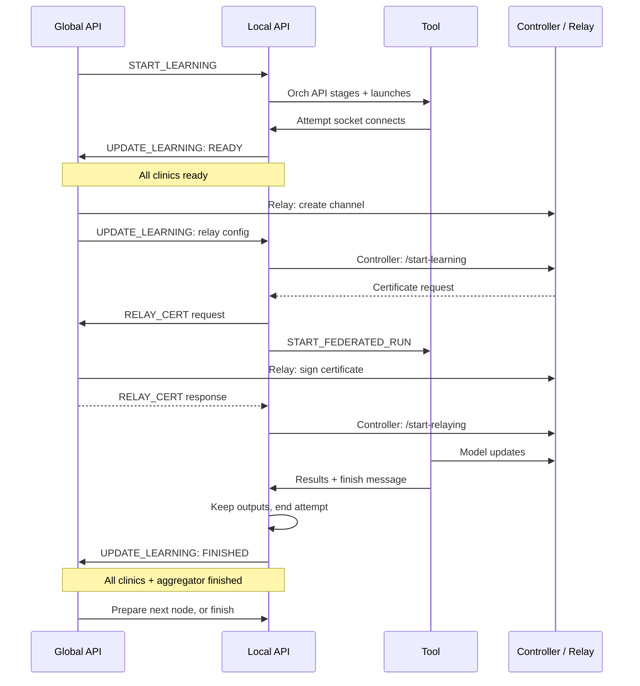

Federated training uses the [execution model](execution-model/index.md): a Platform experiment contains a `TRAINING` / `FEDERATED` run with one step per copied workflow node.
Each Platform step tracks an attempt per clinic, plus a real container attempt when the Platform hosts the aggregator. Each Client owns its local run, steps, and container attempts.
`FederatedTrainingBO` coordinates participants; the single-participant search coordinator leaves federated steps to this flow.

## Identifiers

| ID | Scope |
| --- | --- |
| `globalUniqueExperimentId` | Correlates Platform and Client messages. |
| `uniqueRandomClinicId` / participant ID | Pseudonymous clinic identity within one experiment. |
| Run / step / attempt ID | Database-local; Tool callback `runId` and `APP_ID` identify the **attempt**. |
| Workflow `nodeId` | Correlates the current node across Platform and Clients; stale reports for other nodes are ignored. |
| Relay channel / client ID | Relay session and participant, separate from execution IDs. |

## Message flow

`LEARNING_QUERY` announces the experiment; clinics approve data access before starting.
Client ↔ Platform messages use the FLNet WebSocket (`FedDBClientDataDTO`, `FedDBClientTypeEnum`).
On reconnect, `CURRENT_LEARNINGS` registers experiment subscriptions. `UPDATE_LEARNING` carries `LearningClientSyncRequestDTO` downstream and `LearningClientSyncResponseDTO` upstream; each clinic acts only on its addressed relay configuration.
The Controller joins the Relay after certificate signing; the Tool waits for relay readiness.
Tool lifecycle/logs use the attempt WebSocket; model updates travel through Controller HTTP `:8001` and Relay TCP. The Learning APIs synchronize execution state.

The coordinator is an accepted clinic or, when enabled and requested, the Platform. A Platform aggregator uses the same attempt launcher, callback API, and Controller protocol.
The Platform waits for its aggregator to finish uploading the model before advancing. An error stops training; `STOP_LEARNING` tells Clients to stop attempts, containers, and relay sessions.

## Where to contribute

| Responsibility | Learning-APIs location |
| --- | --- |
| Accept, start, advance, stop | Global `api/project/training/federated/FederatedTraining{BO,SetupBO,ProgressBO,CleanupBO}` |
| Platform aggregator | `FederatedTrainingAggregatorBO`, `FederatedTrainingEventsBO` |
| Client setup, start, certificates, outputs | Local `api/learning/project/run/FederatedLearning*BO` |
| Client status reports | `FederatedLearningEventsBO`: observes `execution-runs`, deduplicates attempt ID/status, calls `FederatedLearningRunBO` to report upstream |
| Participant / relay persistence | Global and Local `execution/federation` |

Debug in order: subscription/acceptance → Tool socket connected → all participants ready → relay/certificate setup → attempt messages → outputs → all participants and aggregator finished.
