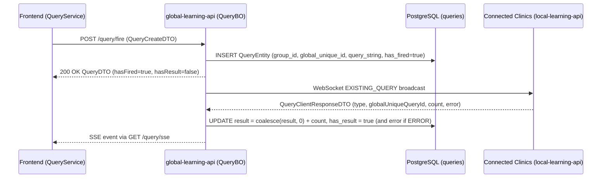

# Query creation & broadcasting

This page describes how `global-learning-api` persists **Lang2Query** definitions (`QueryCreateDTO` / `QueryDTO` carrying `Lang2QueryNodeDTO`), manages immutable version chains via `groupId`, broadcasts fired queries to connected clinic nodes over WebSockets, and streams aggregated counts back to the frontend over Server-Sent Events (SSE).

## Source files

| Role | Path |
| --- | --- |
| REST interface | `global-learning-api/.../api/query/QueryService.java` |
| REST implementation | `global-learning-api/.../api/query/QueryServiceImpl.java` |
| Business logic | `global-learning-api.../api/query/QueryBO.java` |
| MapStruct mapper | `global-learning-api/.../api/query/QueryMapper.java` |
| JPA entity | `global-learning-api/.../api/query/QueryEntity.java` |
| Panache repository | `global-learning-api/.../api/query/QueryAO.java` |
| Clinic reply handler | `global-learning-api/.../api/query/response/QueryResponseBO.java` |
| Federated broadcast | `global-learning-api/.../api/feddbclient/FLNetClientBroadcastBO.java` |
| Shared DTOs & serializer | `core-learning-api/src/main/java/bio/cosy/feddb/core/api/query/` (`QueryDTO`, `Lang2QueryNodeDTO`, `TemporalRelationDTO`, `Lang2QueryDocuments`) |

## Lifecycle

## REST endpoints (`/query`)

| Method | Path | Request / Return | Behavior |
| --- | --- | --- | --- |
| `GET` | `/query` | `List<QueryDTO>` | Returns the **latest version** per `groupId` owned by the caller's `keycloakId`. |
| `GET` | `/query/sse` | `Multi<QueryDTO>` | SSE stream emitting updates for the caller's queries when they represent the latest version of their `groupId`. |
| `GET` | `/query/clients` | `List<String>` | Lists active WebSocket client connection IDs. |
| `GET` | `/query/tre-sources` | `List<TreSourceDTO>` | Lists external TRE databases offered by connected clients. |
| `GET` | `/query/{id}` | `QueryDetailDTO` | Returns the query, `olderQueries` in the same `groupId`, and `enhancedQuery` leaves enriched from `datamodeler-api`. |
| `GET` | `/query/{id}/systems` | `List<QueryResponseDTO>` | Returns responding partner systems (`count > 0`, `error == null`). Per-client count, hardware info, and client name are stripped unless the client supports `ExecutionMode.TRE`. |
| `POST` | `/query` | `QueryCreateDTO` → `201 QueryDTO` | Creates an unfired draft (`hasFired = false`, `hasResult = false`). |
| `PUT` | `/query/{id}` | `QueryDTO` → `200 QueryDTO` | Creates a new draft version in the same `groupId` (`createVersionFromRequest`) with a fresh `globalUniqueId`. |
| `POST` | `/query/fire` | `QueryCreateDTO` → `200 QueryDTO` | Persists a new row (preserving `groupId` when supplied) and immediately broadcasts it (`hasFired = true`). |
| `POST` | `/query/{id}/fire` | `200 QueryDTO` | Fires an unfired draft in place; if already fired (`source.isHasFired()`), clones a new rerun version (`createVersionFromEntity`) in the same `groupId` and fires that copy. |
| `POST` | `/query/{id}/fire-data-statistics` | `200 QueryDTO` | Assigns a new `latestDataStatisticsRequest` UUID + timestamp and broadcasts `ProjectFederatedRequestDataStatisticsDTO`. |
| `DELETE` | `/query/{id}` | `200` | Deletes the query row only if owned by the caller and `!hasFired` (throws `NotAllowedException` once fired). |

## Persistence (`queries` table)

`QueryEntity` stores the Lang2Query document as serialized JSON text via `Lang2QueryDocuments`:

| Column | Type | Notes |
| --- | --- | --- |
| `group_id` | `VARCHAR` (not null) | Shared across edits and reruns of the same logical query. |
| `global_unique_id` | `VARCHAR` (unique, not null) | Unique execution identifier per version row, correlated with clinic replies. |
| `query_string` | `TEXT` | JSON representation of `Lang2QueryNodeDTO` serialized by `Lang2QueryDocuments.toQueryString`. |
| `result` | `INTEGER` | Accumulated privacy-filtered patient count across responding clinics (`null` before first reply). |
| `error` | `TEXT` | Latest clinic error message when a `FedDBClientResponseType.ERROR` reply arrives. |
| `has_fired` | `BOOLEAN` | `true` once broadcast via `FLNetClientBroadcastBO.fireExistingQuery`. |
| `has_result` | `BOOLEAN` | `true` once at least one clinic reply has been processed. |
| `latest_data_statistics_request` | `UUID` | Correlation ID for the latest cross-clinic statistics request. |

## Versioning semantics

Fired queries are immutable audit records:

1. **Draft edits (`PUT /query/{id}`):** `QueryBO.update` copies `groupId` and `keycloakId` from the source entity into a new `QueryEntity` row (`hasFired = false`, `hasResult = false`, new `globalUniqueId`).
2. **Reruns (`POST /query/{id}/fire` on a fired query):** `QueryBO.fireQuery` clones a fresh row in the same `groupId` before setting `hasFired = true` and broadcasting, ensuring prior clinic replies remain attached to the older version's `globalUniqueId`.
3. **List & SSE collapsing:** `QueryBO.getAll` keeps only the newest row per `groupId`, and `QueryServiceImpl.listSSE` filters the `queries` reactive channel with `QueryBO.isLatestVersion`. Historical versions are exposed through `QueryDetailDTO.olderQueries`.

## Handling clinic replies (`QueryResponseBO`)

Connected clinics reply asynchronously on the WebSocket with `QueryClientResponseDTO`:

- **Positive count (`type != ERROR` and `count > 0`):** Persists a `QueryResponseEntity` (including `supportedModes`, connection ID, and optional `clientName` when `shareName` is true) and atomically increments `queries.result = coalesce(result, 0) + count` while setting `hasResult = true`.
- **Error reply (`type == ERROR`):** Treats the clinic's count contribution as `0`, updates `hasResult = true` (initializing `result` to `0` if no positive count arrived yet), and records the clinic's message via `QueryBO.setError(globalUniqueId, error)`.
- Every count or error update emits the refreshed `QueryDTO` onto the `@Channel("queries")` emitter so active `/query/sse` subscribers update immediately.

## Where to start when changing things

| Task | Start here |
| --- | --- |
| Add or modify a Lang2Query node field | `Lang2QueryNodeDTO.java` + `Lang2QueryDocuments.java` (`core-learning-api`), then [`QueryBuilderBO`](../local-learning-api/query-translation-and-privacy.md) and [`frontend/systems/query-system`](../../frontend/systems/query-system.md) |
| Add or change a `/query` endpoint | `QueryService.java` → `QueryServiceImpl.java` → `QueryBO.java` |
| Adjust per-system TRE filtering | `QueryResponseBO.getSystems` |
| User-facing behavior & recipes | [Creating queries user guide](../../../platform-usage/user-guide/queries/index.md) |
