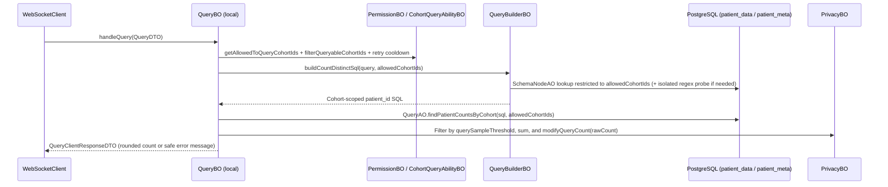

# Query translation & privacy

This page describes how `local-learning-api` validates permissions, compiles a `Lang2QueryNodeDTO` tree into cohort-scoped PostgreSQL against `patient_data`, guards against SQL injection and error oracles, and applies sample thresholds and privacy rounding before returning a `QueryClientResponseDTO`.

## Source files

| Role | Path |
| --- | --- |
| Query orchestration & governance | `local-learning-api/.../api/query/QueryBO.java` |
| Lang2Query SQL compiler | `local-learning-api/.../api/query/QueryBuilderBO.java` |
| Validation / rejection exception | `local-learning-api/.../api/query/QueryRejectedException.java` |
| Per-cohort patient counter | `local-learning-api/.../api/query/QueryAO.java` |
| Matched patient persistence | `local-learning-api/.../api/query/patient/QueryPatientAO.java` |
| Schema-node lookup | `local-learning-api/.../api/schema/schemanode/SchemaNodeAO.java` |
| Cohort queryability filter | `local-learning-api/.../api/cohort/CohortQueryAbilityBO.java` |
| Privacy rounding & suppression | `local-learning-api/.../api/privacy/PrivacyBO.java` |

## End-to-end execution pipeline (`QueryBO.handleQuery`)



### Governance checks before compilation

1. **Replay protection:** If `globalUniqueId` was already processed locally, `handleQuery` returns `0` in production (or the cached count in dev mode) without re-running SQL.
2. **Cohort permissions & queryability:** `PermissionBO.getAllowedToQueryCohortIds(keycloakId)` fetches permitted cohorts, and `CohortQueryAbilityBO.filterQueryableCohortIds(leaves, allowedCohortIds)` narrows them to cohorts that allow querying all referenced ontologies. If either list is empty, execution stops with `"Permission denied"` (`REJECTED_EAM_PRE_HARMONIZED`).
3. **Per-cohort retry cooldown:** `PermissionBO.getQueryRetryTimeByCohort` excludes cohorts queried too recently by the same user. If every remaining cohort is in cooldown, execution stops with `"Query retry time not elapsed for all permitted cohorts. Please wait before retrying."`.

The learning/request execution path (`QueryBO.runQuery(LocalQueryDTO, keycloakId)`) enforces the same permission and `filterQueryableCohortIds` gates, returning an empty result wrapper without running SQL when `allowedCohortIds` is empty.

## Cohort scoping (defense in depth)

Cohort isolation is enforced at **three** independent layers so unauthorized cohorts are never scanned or counted:

1. **Schema-node scoping (`QueryBuilderBO` + `SchemaNodeAO`):**
   - `QueryBuilderBO.buildCountDistinctSql(QueryDTO, Collection<Long> cohortIds)` stores `Set.copyOf(cohortIds)` in a `ThreadLocal` (`COHORT_LIMIT`, cleared in `finally`).
   - `schemaNodesFor(ontologyId, dataTypeId)` (used by both `buildClause` and `columnsFor`) delegates to `SchemaNodeAO.findByOntologyGlobalIdAndCohortIds` / `findByOntologyAndDatatypeGlobalIdAndCohortIds` (`cohort.id in ?n`).
   - If the ontology exists only in non-permitted cohorts, `schemaNodesFor` returns empty and throws `QueryRejectedException("Required condition cannot be found on this node")`.
2. **SQL count scoping (`QueryAO.findPatientCountsByCohort`):**
   - Appends `AND pm.cohort_id IN (:cohortIds)` to `patient_meta` before formatting the `patient_id` subquery, binding `cohortIds` as a JPA query parameter and applying `jakarta.persistence.query.timeout` (`feddb.query.timeout-seconds`, default `120` seconds).
3. **Result post-filter (`QueryBO.runQuery`):**
   - Verifies every returned `QueryResultDTO.cohortId` belongs to `allowedCohortIds` and logs an error if an unexpected cohort ever appeared.

The resulting cohort-scoped `patientMatchSql` is also what `QueryPatientAO.insertMatchedPatients` and `PatientLearningAO` reuse when persisting matched patients for completed queries and approved learning runs.

## Lang2Query SQL compilation (`QueryBuilderBO`)

`QueryBuilderBO` compiles `Lang2QueryNodeDTO` recursively into a `SELECT DISTINCT patient_id` query:

### Boolean groups
- `$and` → `INTERSECT` across child `patient_id` subqueries.
- `$or` → `UNION` across child `patient_id` subqueries (with an optimization collapsing homogeneous `=` leaves on the same ontology/datatype/timeFilter into a single `IN` clause).
- Unsupported fields (such as `scale`, `!contains`, or leaf fields placed on a group node) throw `QueryRejectedException` rather than being silently ignored.

### Leaf execution paths

1. **Absolute comparisons (`buildClause`):**
   - Resolves permitted `SchemaNodeEntity` rows grouped by `patient_data` value column (`value_int`, `value_float`, `value_string`, `value_boolean`, `value_date`, `value_date_time`, `value_blob`) and combines multi-column matches via `UNION`.
   - When `datatype` hint is `Integer` or `Float` alongside magnitude operators (`=`, `!=`, `<`, `<=`, `>`, `>=`), uses `numericValueExpression`: `COALESCE(value_int|value_float, CASE WHEN btrim(value_string) ~ '<regex>' THEN btrim(value_string)::numeric END)`. Rows that fail the strict numeric regex yield `NULL` and are excluded — never compared lexicographically.
2. **Delta & change operators (`buildDeltaClause`, `buildChangeClause`):**
   - `value_mode = "delta"` uses PostgreSQL `LAG(...) OVER (PARTITION BY patient_id, schema_node_id ORDER BY visit_timestamp, id)` for consecutive visit differences (`numeric_value - LAG(numeric_value)`).
   - `value_mode = "delta <interval>"` uses a self-join (`windowPairSelect`) matching any `(earlier, later)` pair of the same patient and schema node with `earlier.visit_timestamp < later.visit_timestamp <= earlier.visit_timestamp + interval '<interval>'`.
   - `has_changed`, `changed_from`, and `changed_to` use `IS DISTINCT FROM` across either consecutive `LAG` rows or windowed self-join pairs.
3. **Time & value aggregations (`buildAggregatedClause`):**
   - Normalizes raw, consecutive-delta, or windowed-delta series into `(patient_id, schema_node_id, event_time, id, agg_value)` and applies:
     - `first` / `last`: `ROW_NUMBER() OVER (PARTITION BY patient_id, schema_node_id ORDER BY event_time ASC|DESC, id ASC|DESC) = 1`.
     - `None` + `average`: `GROUP BY patient_id, schema_node_id HAVING AVG(agg_value) <op> <literal>`.
     - `within <interval>` + `average`: forward sliding-window join `[w.event_time, w.event_time + interval)` with `HAVING AVG(r.agg_value) <op> <literal>`.
     - `within <interval> at least|at most N times`: sliding-window hit counter (`window_count >= N`, or universal `MAX(window_count) <= N`).
4. **Condition occurrence bounds (`buildConditionCountClause`):**
   - When `at_least` or `at_most` is present on a leaf, counts `COUNT(DISTINCT occurrence_key)` per patient. When `at_least == 0` (or unset) and `at_most` is set, `LEFT JOIN`s from `patient_meta` so patients with `0` occurrences are included.
5. **Temporal relations (`buildTemporalGroup`):**
   - Projects occurrence rows `(patient_id, schema_node_id, event_time, id, occurrence_key, visit_id, import_schema_group_id)` and joins `source LEFT JOIN target` per relation (`WITHIN`, `FOLLOWING`, `SAME_TIME` in UTC date, `ANYTIME_AFTER`, `SAME_VISIT`, `SAME_GROUP`), enforcing `MAX(relation_count) >= atLeast` and universal `MAX(relation_count) <= atMost`.
   - For `SAME_GROUP`, `sameGroupScope` restricts `target`'s raw rows to `import_schema_group_id` values matched by `source` prior to evaluating `first` / `last` / `delta` on `target`.

## Safety & error-oracle guarantees

- **Schema-typed literal encoding (`encodeValue`):** Values are validated against the **local schema node's `DataTypes`**, never trusting the client's `datatype` hint:
  - `INT` → `Long.parseLong` rewritten via `Long.toString`.
  - `FLOAT` → strict `^-?\d+(?:\.\d+)?$` rewritten via `BigDecimal.toPlainString`.
  - `BOOLEAN` → exact `"true"` or `"false"`.
  - `DATE` / `DATE_TIME` → parsed via `LocalDate` / `OffsetDateTime` before quoting.
  - `STRING` / `CATEGORICAL` / `FILE` → single-quote doubling (`''`) under PostgreSQL `standard_conforming_strings = on` (and `ESCAPE '\'` for `ILIKE`).
- **Isolated regex pre-validation (`requireValidRegex`):** Before any patient SQL runs, `REGEX` patterns (restricted to `STRING` and `CATEGORICAL`) are tested via `QuarkusTransaction.requiringNew()` with a bound parameter: `SELECT '' ~ :pattern`. PostgreSQL `SQLState 2201B` is translated into `QueryRejectedException("Regular expression is not valid")` without poisoning the outer transaction.
- **Closed error oracle (`QueryBO.handleQuery`):** Deliberate user-facing validation errors (`QueryRejectedException`) return their specific message, whereas any unexpected `Exception` (database errors, timeouts, internal faults) is logged locally with its stack trace and returns the fixed constant `"Query could not be evaluated"` globally.

## Privacy thresholding & rounding

After `QueryAO.findPatientCountsByCohort` returns per-cohort counts:

1. Cohorts where `patientCount < permission.querySampleThreshold` are discarded.
2. Surviving cohort counts are summed (`rawCount`) and passed to `PrivacyBO.modifyQueryCount(rawCount)` for minimum-count suppression and upward rounding.
3. If the resulting `count == 0`, the local status becomes `REJECTED_EAM_POST_HARMONIZED` and the clinic replies with `ERROR: "Query was rejected by privacy measures"`.
4. Otherwise, matched patient IDs are stored asynchronously (`QueryPatientBO.storeMatchedPatientsTransactional`) and the rounded `count` is returned.

## Tests

Run query compiler and permission-scope tests from the `global-learning-apis` root (with the local Postgres dev container running):

```powershell
mvn -pl local-learning-api -am test "-Dtest=QueryBuilderTest,QueryPermissionScopeTest" "-Dsurefire.failIfNoSpecifiedTests=false"
```

## Related pages

- [Global learning API · Query creation & broadcasting](../global-learning-api/query-creation.md)
- [Frontend · Query system](../../frontend/systems/query-system.md)
- [User guide · Conditions, operators & advanced filters](../../../platform-usage/user-guide/queries/conditions-and-filters.md)
