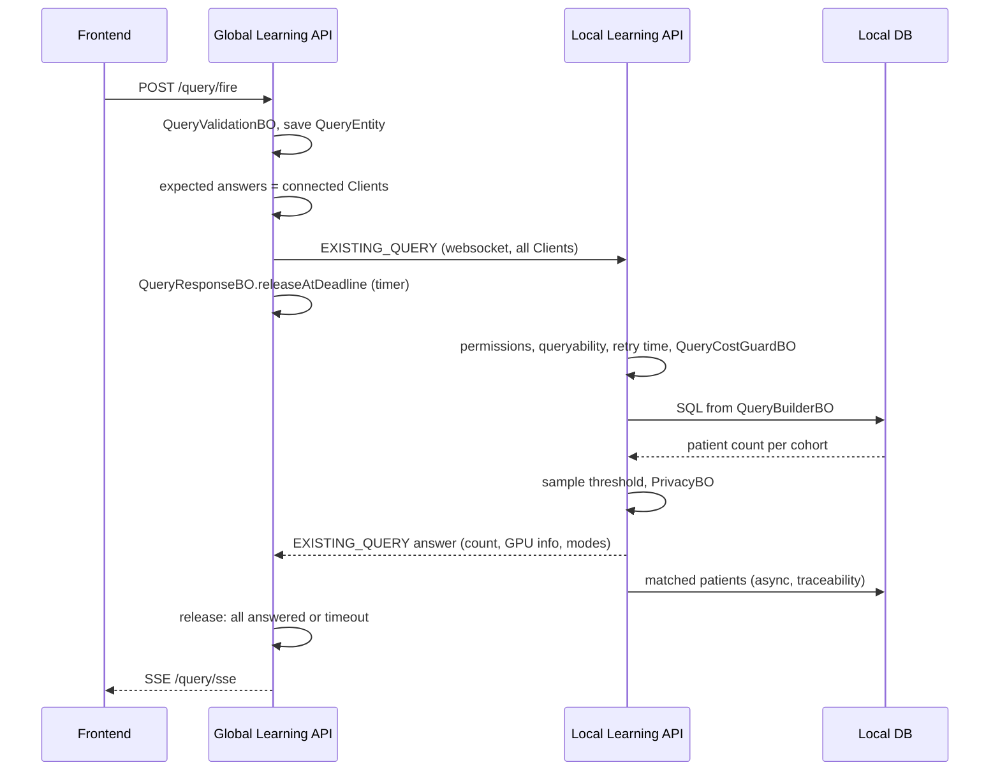
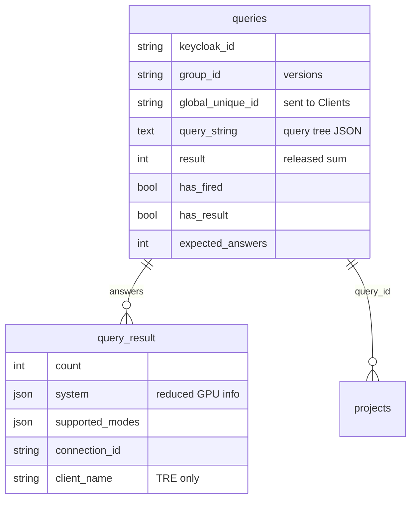
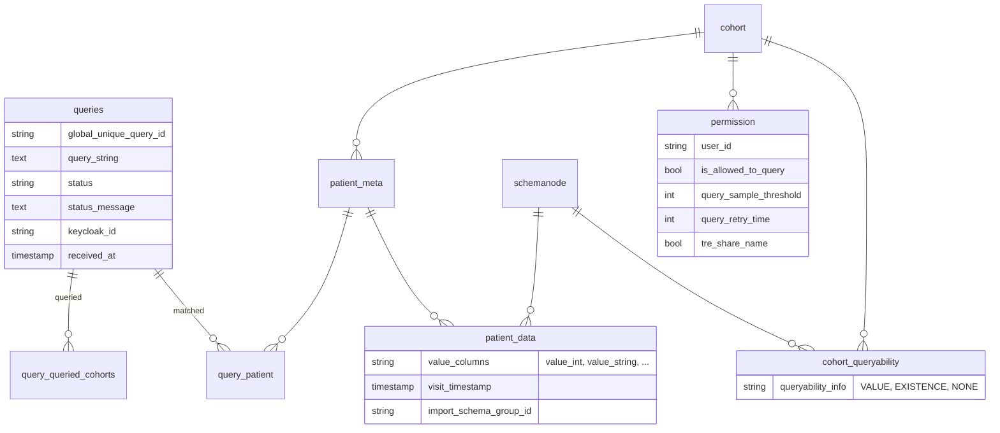

# Federated Query Flow

## Flow

A user builds a query tree in the Platform frontend. The Global Learning API validates and saves it, then sends it over the websocket to every connected Client.

Each Client checks the user's cohort permissions, queryability, retry time and the query size. It then turns the tree into SQL on `patient_data`, counts matching patients per cohort, drops cohorts below their sample threshold and rounds the sum. Only this count goes back, with GPU info and supported modes; the matched patients stay local for traceability.

The Global Learning API waits until all Clients answered, at the latest until the deadline. It then sums the counts, but shows `0` until enough Clients matched. The frontend gets the result over SSE.

## Global Learning API

| Class | Does |
| --- | --- |
| `QueryService(Impl)` | REST `/query`: list, SSE, create, fire, update, delete, `/{id}/systems` |
| `QueryBO` | Validates, saves, versions (`groupId`), fires; a fired query fires again as new version |
| `QueryValidationBO` (core) | Rejects invalid trees; also runs on each Client |
| `FLNetClientBroadcastBO.fireExistingQuery` | Sends the query to all Clients |
| `FLNetClientWebsocketHandlerBO` | Passes answers and the Client's login name to `QueryResponseBO` |
| `QueryResponseBO` | Stores one answer per Client; releases once all answered or at the deadline; answers after release ignored |

Release rules:
- Sum held back as `0` until `min-query-results` Clients matched, or one TRE Client matched.
- Rejections and errors count as `0`.
- Per-Client count, hardware and name only shown for TRE Clients.
- Release timers live in memory only; not restarted after a restart.

## Local Learning API

| Class | Does |
| --- | --- |
| `WebsocketClient` | Receives `EXISTING_QUERY`, adds GPU info, answers |
| `QueryBO.handleQuery` | Checks, runs, applies privacy, stores the query |
| `PermissionBO` | Cohorts the user may query, sample threshold, retry time, TRE modes, name sharing |
| `CohortQueryAbilityBO` | Drops cohorts whose schema nodes are not queryable for the operator |
| `QueryCostGuardBO` | Rejects too many conditions, temporal relations or nesting |
| `QueryBuilderBO` | Query tree → SQL on `patient_data`; groups as `INTERSECT`/`UNION`, temporal relations |
| `QueryOccurrenceBO` | Rows matching one condition: deltas, time windows, first/last, average |
| `QueryPredicateBO` | Operator and value as SQL; values parsed into literals |
| `QueryValueHelper` | Value, data type and interval checks |
| `PrivacyBO.modifyQueryCount` | `0` below `min-count`, otherwise rounds up |
| `QueryPatientBO` | Stores matched patients for traceability |

Answer:
- Rejected before reading data → `ERROR`.
- Anything after (no match, below threshold, SQL error) → `0`.
- Same `globalUniqueId` again → `0`.

Query DTOs (`QueryDTO`, `QueryItemDTO`, `TemporalRelationDTO`, …) live in `core-learning-api` under `bio.cosy.feddb.core.api.query`.

## Configs

| Property | Default | API | For |
| --- | --- | --- | --- |
| `flnet.query.min-query-results` | `3` | Global | Matching non-TRE Clients needed before a result shows |
| `flnet.query.release-timeout` | `PT5M` | Global | Deadline of the release |
| `flnet.privacy.query.min-count` | `100` | Local | Counts below become `0` |
| `flnet.privacy.query.max-conditions` | `30` | Local | Cost guard |
| `flnet.privacy.query.max-temporal-relations` | `5` | Local | Cost guard |
| `flnet.privacy.query.max-depth` | `6` | Local | Cost guard |
| `feddb.query.timeout-seconds` | `120` | Local | SQL statement timeout |
| `flnet.cohort.cohort-permission.is-allowed-to-query` | `true` | Local | Default permission of new cohorts |
| `flnet.cohort.cohort-permission.query-sample-threshold` | `100` | Local | Default min. count per cohort |
| `flnet.cohort.cohort-permission.query-retry-time` | `3` | Local | Default seconds between queries per user and cohort |

Per cohort, the permission and queryability values are changed in the Instance Manager Frontend.

## Persistence

Global Learning API DB:

Local Learning API DB:

