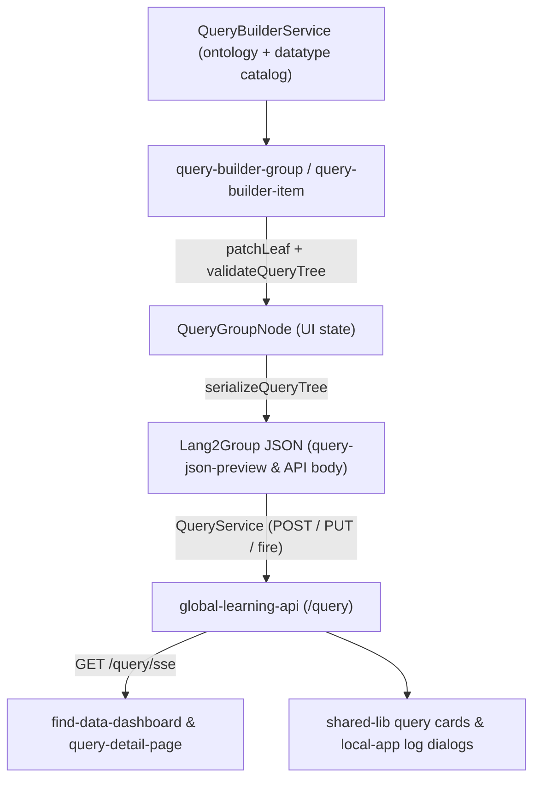

# Query System

The query system spans `global-app`, `shared-lib`, and `local-app` in `frontend-shared`:

- In **`global-app`**, it powers the **Find Data** (`find-data`) workspace, the interactive **Lang2Query** tree builder, JSON request preview, version history, and cross-clinic statistics panel.
- In **`shared-lib`** and **`local-app`**, it provides reusable query summary/detail cards and local query-log inspection dialogs used across patient, training, and governance views.

## Where it lives

| Area | Path in `frontend-shared` |
| --- | --- |
| Global Find Data module & routes | `projects/global-app/src/app/modules/find-data/` |
| Lang2Query wire types | `projects/global-app/src/app/modules/find-data/dto/lang2-query.ts` |
| Query API DTOs (`QueryDTO`, `QueryDetailDTO`, `QueryOperatorTypes`) | `projects/global-app/src/app/modules/find-data/dto/query.ts` |
| UI tree draft model (`QueryGroupNode`, `QueryLeafNode`) | `projects/global-app/src/app/modules/find-data/models/query-tree.ts` |
| Operator catalog per `DataTypes` | `projects/global-app/src/app/modules/find-data/configs/query-option.ts` |
| Combination & auto-reset rules (`patchLeaf`) | `projects/global-app/src/app/modules/find-data/helpers/query-tree.rules.ts` |
| Tree validation (`validateQueryTree`) | `projects/global-app/src/app/modules/find-data/helpers/query-tree.validator.ts` |
| Wire serializer & hydrator (`serializeQueryTree`, `hydrateQueryTree`) | `projects/global-app/src/app/modules/find-data/helpers/query-tree.serializer.ts` |
| Derived run status (`draft`, `pending`, `finished`, `failed`) | `projects/global-app/src/app/modules/find-data/helpers/query-status.ts` |
| HTTP + SSE client | `projects/global-app/src/app/modules/find-data/services/query.service.ts` |
| Shared query overview & detail cards | `projects/shared-lib/src/lib/modules/query/` |
| Local query log detail dialog | `projects/local-app/src/app/modules/query/` |
| UI translations (`QUERY_BUILDER`, `QUERY_STATUS`) | `projects/shared-lib/src/assets/i18n/en.json` |

## Frontend data flow

## Two-layer model: UI draft tree vs. Lang2Query wire JSON

Instead of mutating raw backend DTOs directly in Angular forms, `find-data` separates the **editable UI tree** from the **wire format**:

1. **UI draft state (`models/query-tree.ts`):**
   - `QueryGroupNode` holds `connectingOperator` (`'$and' | '$or'`), `children` (`QueryNode[]`), `relations` (`TemporalRelationDraft[]`), and UI `collapsed` state. Reordering or removing children automatically shifts `TemporalRelationDraft` `source` and `target` indexes (`insertChild`, `removeChild`, `moveChild`).
   - `QueryLeafNode` stores structured form state (`ontologyId`, `dataTypeId`, `catalogType`, `operator`, `value`, `datatypeHint`, `valueMode`, `deltaInterval`, `timeFilterChoice`, `timeAfter`, `timeBefore`, `timeAggregation`, `timeWindow`, `timeWindowCount`, `valueAggregation`, `atLeast`, `atMost`).
2. **Constraint transitions (`helpers/query-tree.rules.ts`):**
   - `patchLeaf` enforces mutual exclusions immediately as the user clicks segmented controls (for example, selecting `has_changed` forces `valueMode: 'delta'` and clears aggregations; selecting `timeAggregation: 'within'` sets `valueAggregation: 'average'` and `valueMode: 'absolute'`).
3. **Validation (`helpers/query-tree.validator.ts`):**
   - `validateQueryTree` returns path-tagged `QueryTreeIssue` items (`missing-catalog`, `missing-operator`, `missing-value`, `integer-value`, `within-requires-average`, `date-after`, `at-least-above-at-most`, `relation-same-endpoint`, etc.) that gate the **Save** and **Send Request to All Clinics** buttons.
4. **Serialization & hydration (`helpers/query-tree.serializer.ts`):**
   - `serializeQueryTree(group)` emits snake_case `Lang2Group` / `Lang2Leaf` JSON (`connecting_operator`, `ontology_id`, `data_type_id`, `value_mode`, `time_filter`, `time_aggregation_method`, `value_aggregation_method`, `temporal_relations`), feeding both `QueryService` requests and `<app-query-json-preview>`.
   - `hydrateQueryTree(wire, configs)` parses stored `QueryDTO.query` payloads back into `QueryGroupNode` when opening a query or rendering version outlines.

## Derived status model (`helpers/query-status.ts`)

`QueryDTO` has boolean flags (`hasFired`, `hasResult`) rather than a backend status enum. Both the workspace table and detail page compute badges via `queryStatus(query)`:

- **`finished` (`GREEN`):** `hasResult && typeof result === 'number' && Number.isFinite(result)`
- **`failed` (`RED`):** `error?.trim()` is non-empty or `hasResult` is true without a numeric `result`
- **`pending` (`BLUE`, pulsing indicator):** `hasFired` is true while awaiting the first clinic reply
- **`draft` (`GRAY`):** unfired saved query

## Key UI components

- `find-data-dashboard`: Workspace table with live `/query/sse` updates, client-side filtering, context menu for drafts (**Edit**, **Run query**, **Delete**, **Go to project**), and creation dialog launcher.
- `query-detail`: Modal dialog used when creating a new query or editing directly from the workspace table.
- `query-detail-page`: Full route (`/find-data/:id`) with **Overview**, **Query Builder**, **Versions** (read-only timeline built from `QueryDetailDTO.olderQueries`), and **Statistics** (`query-statistics-panel`) tabs.
- `query-builder-group`, `query-builder-item`, `query-interval-field`, `query-json-preview`: Recursive tree editor components.

## What to edit for common tasks

| Task | Start here |
| --- | --- |
| Add a new operator to the UI | `dto/query.ts` + `dto/lang2-query.ts` + `configs/query-option.ts` + `helpers/query-tree.rules.ts` + `helpers/query-operator.helper.ts`, then mirror in [`local-learning-api`](../../backend/local-learning-api/query-translation-and-privacy.md) |
| Change longitudinal combination rules | `helpers/query-tree.rules.ts` (`patchLeaf`) + `helpers/query-tree.validator.ts` + unit tests in `helpers/query-tree.spec.ts` |
| Change wire JSON serialization or human-readable summaries | `helpers/query-tree.serializer.ts` |
| Change status badge derivation | `helpers/query-status.ts` + `helpers/query-status.spec.ts` |
| Change shared or local query cards/log dialogs | `projects/shared-lib/src/lib/modules/query` and `projects/local-app/src/app/modules/query` |

## Adjacent systems

- Global persistence, versioning, and SSE: [Global learning API · Query creation & broadcasting](../../backend/global-learning-api/query-creation.md)
- SQL compilation, cohort scoping, and privacy: [Local learning API · Query translation & privacy](../../backend/local-learning-api/query-translation-and-privacy.md)
- Schema and ontology catalog semantics: [Data modeling system](data-modeling-system.md)
- Local request/governance consumers: [Local operations system](local-operations-system.md)
- End-user Query Builder documentation: [Creating queries](../../../platform-usage/user-guide/queries/index.md)
