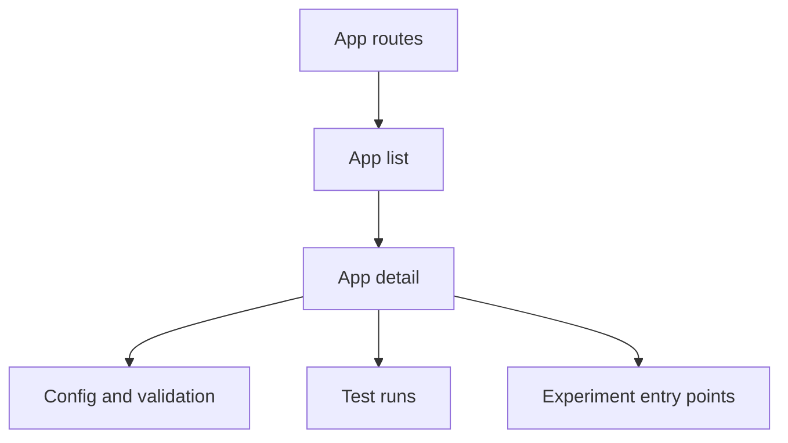

The tool development system is the app-builder side of the frontend. It is where contributors manage app definitions, configuration, startup behavior, test runs, and experiment views for a tool.

## Where it lives

- route entry: `projects/global-app/src/app/modules/tool-development/test-app-routing.module.ts`
- main implementation: `projects/global-app/src/app/modules/tool-development`

## What belongs here

- app list and app detail
- app config editors
- client config views
- startup and validation helpers
- app run and test views
- experiment views attached to an app

## System boundary

Start here when the change is about tool authoring, app metadata, client config, validation, or app-owned experiment entry points.

Do not start here for the shared workflow editor or execution runtime internals. Those usually belong to [Workflow system](workflow-system.md) or [Data analysis system](data-analysis-system.md).

## Route shape

## What to edit for common tasks

| Task | Start here |
| --- | --- |
| change app list or app detail screens | `projects/global-app/src/app/modules/tool-development/components` |
| change config form behavior | `components/app-detail-config` |
| change startup or validation handling | `helper`, `dto`, and validation services in the same module |
| change backend calls or route resolving | `projects/global-app/src/app/modules/tool-development/service` |
| change the run-mode selector, step display, or scan reports | `projects/global-app/src/app/modules/pipeline` |
| change the manual rescan action | `modules/pipeline/components/pipeline-publish-info-dialog` in the global app |
| change shared SAST result types | `projects/shared-lib/src/lib/modules/store/dto/publish-info.ts` |

## Pipeline modes, scan reports, and rescans

The pipeline list offers **Build and publish** (`ALL`).
Model contexts with uploaded files also offer **Local build from uploaded files** (`LOCAL_BUILD`).
The selected mode is sent as `runMode` and displayed in the pipeline list and detail view.

`pipeline-publish-info-detail` displays SAST alongside vulnerability and malware results. SAST uses
its own result types, native severity counts, findings with source locations, completeness status,
scanner errors, and raw report. Missing or incomplete scans must remain distinguishable from a
clean scan.

`app-detail-config/components/app-edit` opens the scan-results dialog when the user clicks the
Docker image badge. It passes the publish information and app version ID to
`pipeline-publish-info-dialog`, which owns the frontend's only **Rescan vulnerabilities** action.
The dialog projects that button into the **Vulnerability scan** panel header; other uses of the
publish-info detail component do not receive a rescan action.
The dialog creates an `APP` pipeline with `runMode: SCAN_ONLY` and opens its live details.
The backend checks permissions and rejects a rescan if the tool version already has an active run.

The shared `docker-image-tag` component displays eight characters for commit hashes and keeps the
full image reference in its tooltip.

See the [Tool Build Pipeline](../../../tool-dev/building-pipeline.md) for user-facing behavior and
[Pipeline integration and local testing](../../backend/tool-build-pipeline.md) for the API contract,
local registry, and scheduler setup.

## Adjacent systems

- app experiment pages usually continue into [Experiments system](experiments-system.md)
- config changes that affect runtime execution often require checks in [Data analysis system](data-analysis-system.md)

## What usually trips people up

- This system owns the tool authoring flow, not the shared execution runtime.
- Experiment pages under `/app/:app-id/experiment/...` still belong here first.
- A config change often has a second impact on the data-analysis system, because execution UI reads the resulting tool definition later.
