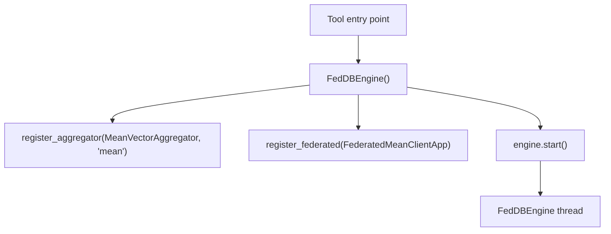
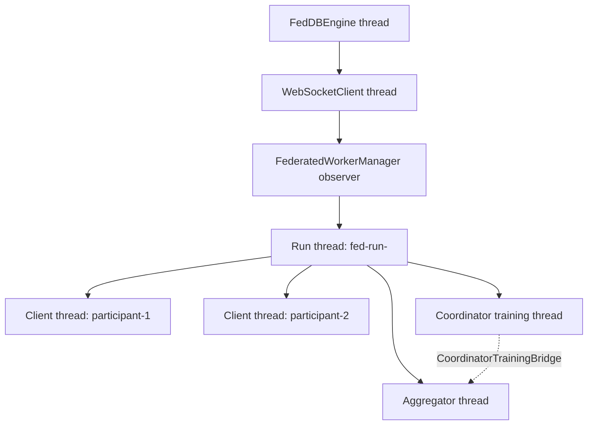
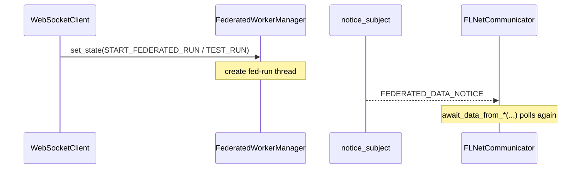
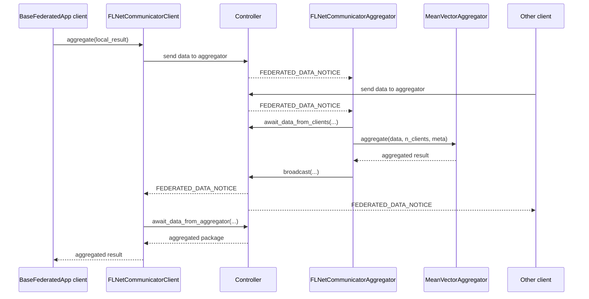
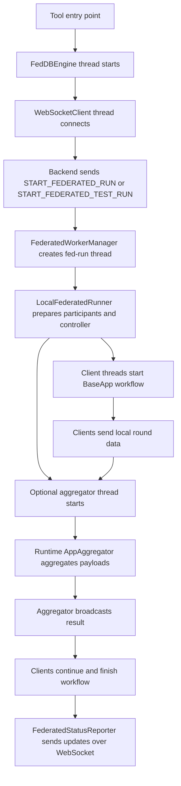

# Federated Runtime (pyfedappwrap)

This page explains the inside of the [Python-Tool-API](https://github.com/FedLearnNet/Python-Tool-API)
(`pyfedappwrap`) during a federated run: how the engine starts, which thread owns which job, and how
data moves between the main classes. For the platform side of a run (global API, local API,
controller registration, result harvest) see
[Federated Learning Flow](../backend/federated-learning-flow.md), Phase 5 of which is the
summary of this page.

The design follows two principles:

- client logic lives in apps derived from `BaseFederatedApp`
- aggregation logic lives in runtime-owned `AppAggregator` services, not in app instances

## 1. Entry Point

A tool registers its apps on the engine. The local demo in `scripts/run_federated.py` shows the
minimal setup:

1. select the config file with `system_settings.config_settings_path`
2. create the engine with `FedDBEngine()`
3. register a runtime aggregator service, e.g. `register_aggregator(MeanVectorAggregator(), "mean")`
4. register the federated app template, e.g. `register_federated(FederatedMeanClientApp())`

`engine.start()` then starts the engine in its own background thread. The demo also sets
`system_settings.fl_test.use_dockerized_controller = True`, so its test runs use the dockerized
controller (see [Controller Modes](#5-controller-modes)).

## 2. Main Runtime Objects

| Object | Role |
|---|---|
| `FedDBEngine` | Starts and owns the top-level runtime infrastructure |
| `WebSocketClient` | Subject that forwards incoming socket events to observers |
| `FederatedWorkerManager` | Observer that starts a federated run when a start event arrives |
| `LocalFederatedRunner` | Executes one federated run with one thread per executed participant. Lives in `engine/tests/federated/runner.py`, but is the production runner |
| `BaseFederatedApp` | Base class for client apps; provides the federated configuration and a default `FLNetCommunicatorClient` |
| `FLNetCommunicatorClient` | Client-side API for sending local data and waiting for aggregated results |
| `FLNetCommunicatorAggregator` | Runtime-side API for waiting for client payloads, calling the registered aggregator service and broadcasting results |
| `FederatedStatusReporter` | Sends run state, participant state and round-message updates back over the WebSocket |

## 3. Thread Model

### Engine thread

`FedDBEngine` is a `threading.Thread`. In `run()` it starts the shared infrastructure:

- the `WebSocketClient` thread
- the config file watcher (dev mode with `ENABLE_CONFIG_SYNC`) and the system watcher (`TRACE_PERFORMANCE`)
- the observer-based `WorkerManager` and `FederatedWorkerManager`

### WebSocket thread

`WebSocketClient` is also a `threading.Thread`. It receives backend messages, parses them into
`BaseSocketMessage` and publishes them with `self.set_state(event)`. `WorkerManager` and
`FederatedWorkerManager` are subscribed to it.

### Federated run thread

For each start event, `FederatedWorkerManager` creates one thread named `fed-run-<run_id>`
(duplicate starts of a running id are ignored). It builds the participants, stages their input
files, builds the run config and starts `LocalFederatedRunner`.

### Participant threads

`LocalFederatedRunner` creates:

- one thread per executed client participant (`fl-local-<participant>`)
- one aggregator thread (`fl-local-agg-<participant>`) for the aggregator participant, if `startAggregator` is enabled
- an additional training thread for the aggregator participant: the coordinator trains on its own
  data as well, and `CoordinatorTrainingBridge` feeds its local update into the aggregation
  in-process

Which participants are executed depends on the run type (see [Controller Modes](#5-controller-modes)).

## 4. Start Events and Run Types

`FederatedWorkerManager` reacts to two messages:

- `START_FEDERATED_RUN`
- `START_FEDERATED_TEST_RUN`

A run is a **test run** if the event is `START_FEDERATED_TEST_RUN` *or* it carries
`runType=FEDERATED_TEST_RUN`; otherwise it is a **real run**. For both, the worker manager:

1. reads the payload as `FederatedTestRunCreateDTO`
2. builds `FLNetLocalParticipantConfigDTO` objects
3. builds the run config `FLNetLocalTestConfigDTO`
4. starts the `fed-run-<run_id>` thread
5. lets `LocalFederatedRunner` execute the run

On real runs, participants without an explicit output dir write to `OUTPUT_DIR`, the platform's
output volume, so the local API can harvest the results.

## 5. Controller Modes

Federated data never goes directly from app to app; it goes through a controller.

| Run type | Controller | Participants executed by this instance |
|---|---|---|
| Real run | External controller at `FL_RUN__CONTROLLER_COMM_URL` | Exactly one: this instance's participant |
| Test run | In-memory `FLNetInMemoryController` | All participants, simulated locally |
| Test run with `FL_TEST__USE_DOCKERIZED_CONTROLLER=true` | Dockerized controller at `FL_TEST__DOCKERIZED_CONTROLLER_COMM_URL`; the services are started with docker compose if they are not healthy | All participants, simulated locally |

A real run identifies its own participant by `participantId == APP_ID`, by being the only
participant, or by a unique `hyper_params.app_id` / `hyper_params.local=true` match. Otherwise
the run fails with an *"identify this app instance"* error.

## 6. Aggregator Gating

The start DTO controls whether the aggregator thread starts. The incoming `startAggregator`
field is stored in `FLNetLocalTestConfigDTO.start_aggregator`:

- `true`: the runner starts the aggregator thread
- `false`: the aggregator participant is skipped
- if the aggregator thread is started, a runtime aggregator service must be registered on
  `FedDBEngine`; otherwise the run fails with
  `KeyError: No runtime aggregator registered for the configured aggregator participant.`

Aggregation is runtime-owned: apps do not own or register aggregators.

## 7. Observer Pattern

The observer pattern is used in two places.

### WebSocket start events

- `WebSocketClient` is the `Subject`, `FederatedWorkerManager` an `Observer`
- `WebSocketClient.handle_event()` calls `self.set_state(event)`
- `FederatedWorkerManager.update()` receives the event and starts the run

### Federated data notices

Receiving data polls the controller up to `max_polls` times, every `poll_interval`. Between two
polls the communicator waits for a `FEDERATED_DATA_NOTICE`, which wakes it up early.

With the in-memory controller:

- `FLNetInMemoryController.notice_subject` is the `Subject`
- each communicator subscribes with `bind_notice_subject(...)` and unsubscribes after the run
- when data for a participant arrives, the controller publishes a `FEDERATED_DATA_NOTICE`
- the waiting `await_data_from_*` call polls again immediately

## 8. Client App Lifecycle

Client apps run through the normal `BaseApp` lifecycle. For each client thread the runner:

1. calls `configure_federation(...)` with controller URL, app keys, client/aggregator ids and channel
2. validates the participant's hyperparameters against the app's config type
3. calls `set_startup(...)`
4. configures the communicator (in-memory session and notice subscription, polling settings)
5. builds the typed input from `input_file_paths`
6. calls `app.start(config, input, mode)`

So config loading, input and output validation, `send_output(...)`, and finish and status
messages work as in a non-federated run.

## 9. One Round

1. a client app computes its local result in `run_train(...)`
2. it calls `self.communicator.aggregate(...)` (or `send_data_to_aggregator(...)` followed by `await_data_from_aggregator(...)`)
3. the communicator posts the payload to the controller (`/send-data-to-aggregator`)
4. the controller notifies the aggregator
5. the aggregator collects one package per client with `await_data_from_clients(...)`
6. the registered `AppAggregator` aggregates the payloads
7. the aggregator broadcasts the result with `broadcast(...)`
8. the clients receive it in `await_data_from_aggregator(...)`
9. the app continues and finishes its normal workflow

## 10. Client Communication API

`FLNetCommunicatorClient` (the `communicator` of a `BaseFederatedApp`):

| Method | Purpose |
|---|---|
| `send_data_to_aggregator(...)` | Send local data to the aggregator |
| `await_data_from_aggregator(...)` | Wait for the aggregator's answer |
| `aggregate(...)` | Round-trip shortcut: send to the aggregator, wait, return the aggregated package |
| `send_data_to_clients(...)` | Send data peer-to-peer to other clients |
| `await_data_from_clients(...)` | Wait for data from other clients |

The transport itself (`_send_to_aggregator`, `_send_to_clients_p2p`, `_send_to_clients_broadcast`,
the receive helpers, SMPC and DP settings) is private to the shared base class `FLNetCommunicator`.

## 11. Aggregator Communication API

The aggregator thread uses `FLNetCommunicatorAggregator`:

| Method | Purpose |
|---|---|
| `register_aggregator(...)` | Attach the runtime `AppAggregator` |
| `await_data_from_clients(...)` | Collect the client packages of a round |
| `aggregate(...)` | Call the registered `AppAggregator.aggregate(data, n_clients, meta)` |
| `broadcast(...)` | Send the result to all clients |

`FLNetCommunicatorAggregator.aggregate(...)` does not implement an algorithm; classes like
`MeanVectorAggregator` do. This keeps the runtime orchestration separate from the aggregation
strategy.

## 12. WebSocket Reporting

`FederatedStatusReporter` reports:

- run state with `update_run(...)` and `finish_run(...)`, sent as `UPDATE_FEDERATED_RUN` / `FINISH_FEDERATED_RUN`
- participant state with `update_participant(...)`, sent as `FEDERATED_PARTICIPANT_UPDATE`
- round traffic with `round_message(...)`, sent as `FEDERATED_ROUND_MESSAGE`

The communicators report round traffic themselves: sending emits a `SEND` event, receiving a
`RECEIVE` event, and the participant counters `messages_sent` / `messages_received` follow the
actual data flow.

## 13. End-to-End Summary

In short:

- the engine starts the shared runtime, and the WebSocket triggers federated runs
- the worker manager creates one run thread per run
- the runner creates one thread per executed participant, plus the aggregator
- real runs use the external controller and execute one participant; test runs simulate all participants locally
- apps communicate through communicator classes and the controller
- the aggregator is runtime-owned and independent of the app classes
- the normal app lifecycle and federated round reporting both stay active
