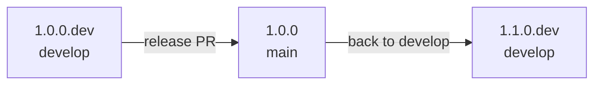

# Release workflow
This page describes how a new FL-Net version is released: which version number goes where, which steps you do by hand, and what the CI does automatically.

All FL-Net repositories listed below share **one version** and are released together. A Client running `1.0.0` therefore runs `1.0.0` images of every local server component.

## Version scheme
A version has one of two forms:

| Version | Meaning | Branch | Example |
|---|---|---|---|
| `X.Y.Z.dev` | Work in progress towards `X.Y.Z` | `develop` | `1.1.0.dev` |
| `X.Y.Z` | Release | `main` | `1.1.0` |

The order is `1.1.0.dev` < `1.1.0` < `1.1.1` < `1.2.0.dev`.

Pick the next number like this:
- **Major** `X`: incompatible changes, for example when Clients and Platforms of different major versions can no longer work together.
- **Minor** `Y`: new features. This is the usual step after a release, e.g. `1.0.0` → `1.1.0.dev`.
- **Patch** `Z`: bug fixes only, typically a [hotfix](#hotfix) on `main`.

One version runs through these stages:

## Where the version is stored
Each repository stores the version in the place its ci/cd expects (e.g. pom.xml). The versioning comes in two halves:
- `.github/scripts/version.sh` in every repository only knows where that repository keeps its version, and reads or changes it.
- The rules are the same for all repositories, so they live once in [FedLearnNet/.github](https://github.com/FedLearnNet/.github) as the action `actions/version`. They cover the format, which branch takes which version, and what a build publishes. Every repository's CI uses that action, so a rule change happens in one place.

So the version is set in the code specific version way depending on the programming language, based on this github and docker tags are set.
The version change is only done at release time, look at this part of the release workflow.
## What CI does automatically
On every push to `main` or `develop`, the image workflows (`docker.yml`, in the CLI `release.yml`) first run the shared `actions/version`. That step checks the version and decides what gets published:

| Version on the branch | Image tags | Git tag and GitHub release |
|---|---|---|
| `develop`, `X.Y.Z.dev` | `staging`, `staging-<sha>`, `X.Y.Z.dev` (moves with every build) | none |
| `main`, `X.Y.Z`, first build | `latest`, `latest-<sha>`, `X.Y.Z` (Learning-APIs also `prod`) | tag `X.Y.Z`, release |
| `main`, `X.Y.Z` that already has a tag | only `staging`/`latest` and the `<sha>` tag, plus a warning | none |

Releases are **published once and then stay fixed**. As long as the version is not raised, later builds keep updating `latest`, but `X.Y.Z` keeps pointing to the build that was released. To publish fixes, raise the version, see [Hotfix](#hotfix).

The CI also:
- **Writes the release notes**: the GitHub release lists the pull requests merged since the previous tag.
- **Labels the images** with `org.opencontainers.image.version`, so `docker inspect` shows the version of a running container.
- **Builds and attaches the CLI binaries**: in FL-Net-CLI, the first build of a new release builds the native binaries and `flnet.jar` and attaches them to the GitHub release. Every `main` build still replaces the rolling `latest` release.
- **Guards the branches**:
  - The *Version* workflow runs on every pull request into `main` or `develop`.
  - `main` only takes a release version `X.Y.Z` that has no tag yet.
  - `develop` only takes `X.Y.Z.dev`. A release version would publish the staging build under the release tag.
  - A push that breaks these rules fails the image workflow.

What stays manual: choosing the version number, opening the pull requests that change it, and testing `develop` on staging before a release.

### The version at runtime
- Both learning APIs report their version at `GET /info`, publicly, as it contains nothing secret. The Local Learning API also asks the Platform for its version and caches the answer for a day. If the Platform is not reachable, `globalVersion` stays empty and the next call asks again. It returns `globalVersionNewer: true` if the Platform runs a newer version, plus `globalWebUrl`, the address of the Platform frontend.
- The Client and Platform frontends show the version in the footer. Both load it right at the start, before the login, and show a one-line skeleton until it arrives. The Client frontend adds a hint when the Platform is newer. Instead of the former `globalWebUrl` build setting, it uses the address from `GET /info`. The Local Learning API derives that address from `QUARKUS_REST_CLIENT_GLOBAL_API_URL` without its `/api` path.
- The Orchestration API starts the Tool-Build-Pipeline image of its own version (`pipeline.image-tag`, default: its version). The tag sent by the Global API is ignored. For a locally built pipeline image, set `PIPELINE_IMAGE_TAG`.
- `flnet update` checks the GitHub releases for a newer CLI and prints the install command.

## Releasing step by step
The examples release `1.1.0`; replace the numbers with yours. Do every step in **all repositories** listed above, so the whole network stays on the same version.

### 1. Develop
`develop` carries `1.1.0.dev`. Nothing to do: features are merged as described in the [Development workflow](development-workflow.md), and every build is published as `staging` and `1.1.0.dev`.

### 2. Release
When `develop` passes the tests on staging:

1. Create a branch `release/1.1.0` from `develop`.
2. Run `.github/scripts/version.sh set 1.1.0` and commit.
3. Open a pull request into `main`. The *Version* check confirms that `1.1.0` is not released yet.
4. Merge it.

The CI publishes the `1.1.0` and `latest` images, the tag `1.1.0` and the GitHub release. Check the generated release notes on GitHub and complete them if needed.

### 3. Back to develop
Start the next version on `develop`, so it also contains the release commit:

1. Create a branch from `develop`, e.g. `chore/1.2.0.dev`.
2. Merge `main` into it (`git merge origin/main`).
3. Run `.github/scripts/version.sh set 1.2.0.dev` and commit.
4. Open a pull request into `develop` and merge it.

Until this is done, `develop` still carries `1.1.0.dev`. That is fine, it just keeps updating `staging`.

### Hotfix
A bug in a release that cannot wait for the next one:

1. Create a branch `hotfix/1.1.1` from `main`.
2. Fix the bug, run `.github/scripts/version.sh set 1.1.1` and commit.
3. Open a pull request into `main` and merge it. The CI publishes `1.1.1` like a release.
4. Bring the fix to `develop`: merge `main` into a branch from `develop` and open a pull request. If the version line conflicts, keep the version of `develop`.

Only the repositories with the fix need a hotfix release, the others stay on `1.1.0`.

## Troubleshooting
**`develop takes X.Y.Z.dev`**: a release version reached `develop`, usually by merging `main` without step 3. Set the next `.dev` version.

**`main only takes release versions`**: the pull request into `main` still carries a `.dev` version. Release via a `release/X.Y.Z` branch as in step 2.

**`X.Y.Z is already released. Raise the version`**: there is already a tag for this version. Use the next patch version for a fix.

**Warning `… was already released from <sha>`**: changes reached the branch without a new version. They are published as `staging`/`latest`, but not under the version tag. Raise the version to publish them.

**A wrong release was published**: don't move the tag. Publish the next patch version instead, e.g. `1.1.1`. Deleting a GitHub release and its tag lets the next build publish the same version again, which may confuse deployments that already pulled it.
