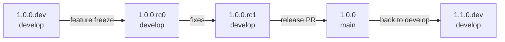

# Release workflow
This page describes how a new FL-Net version is released: which version number goes where, which steps you do by hand, and what the CI does automatically.

All FL-Net repositories listed below share **one version** and are released together. A Client running `1.0.0` therefore runs `1.0.0` images of every local server component.

## Version scheme
A version has one of three forms:

| Version | Meaning | Branch | Example |
|---|---|---|---|
| `X.Y.Z.dev` | Work in progress towards `X.Y.Z` | `develop` | `1.1.0.dev` |
| `X.Y.Z.rcN` | Release candidate `N` of `X.Y.Z`, counted from `0` | `develop` | `1.1.0.rc0`, `1.1.0.rc1` |
| `X.Y.Z` | Release | `main` | `1.1.0` |

The order is `1.1.0.dev` < `1.1.0.rc0` < `1.1.0.rc1` < `1.1.0` < `1.1.1` < `1.2.0.dev`.

Pick the next number like this:
- **Major** `X`: incompatible changes, for example when Clients and Platforms of different major versions can no longer work together.
- **Minor** `Y`: new features. This is the usual step after a release, e.g. `1.0.0` → `1.1.0.dev`.
- **Patch** `Z`: bug fixes only, typically a [hotfix](#hotfix) on `main`.

One version runs through these stages:



## Where the version is stored
Each repository stores the version in the place its build tool expects. You never edit these files by hand. The versioning comes in two halves:
- `.github/scripts/version.sh` in every repository only knows where that repository keeps its version, and reads or changes it.
- The rules are the same for all repositories, so they live once in [FedLearnNet/.github](https://github.com/FedLearnNet/.github) as the action `actions/version`. They cover the format, which branch takes which version, and what a build publishes. Every repository's CI uses that action, so a rule change happens in one place.

| Repository | Version stored in | Published with the version |
|---|---|---|
| [Learning-APIs](https://github.com/FedLearnNet/Learning-APIs) | `pom.xml` (all modules inherit it) | images `global-learning-api`, `local-learning-api`, `datamodeler-api` |
| [Orchestration-API](https://github.com/FedLearnNet/Orchestration-API) | `pom.xml` | image `orch-api` |
| [FL-Net-CLI](https://github.com/FedLearnNet/FL-Net-CLI) | `pom.xml` | GitHub release with native binaries and `flnet.jar` |
| [Frontends](https://github.com/FedLearnNet/Frontends) | `package.json` and `package-lock.json` | images `local-*`, `global-*` of every brand |
| [Documentation](https://github.com/FedLearnNet/Documentation) | `package.json` and `package-lock.json` | image `flnet-user-doc` |
| [Federated-Learning-Communication-API](https://github.com/FedLearnNet/Federated-Learning-Communication-API) | `VERSION` | images `controller`, `controller-relay` |
| [Tool-Build-Pipeline](https://github.com/FedLearnNet/Tool-Build-Pipeline) | `VERSION` | image `pipeline` |

[Python-Tool-API](https://github.com/FedLearnNet/Python-Tool-API) is versioned on its own, because Tools pin it as a PyPI package (`flnet.tool.sdk-version` in the CLI).

```bash
.github/scripts/version.sh                    # print the version
.github/scripts/version.sh set 1.1.0.rc0      # change it
```

`set` does not validate the version; the *Version* check of the pull request does. To run that check yourself, with [FedLearnNet/.github](https://github.com/FedLearnNet/.github) cloned next to the repositories:

```bash
bash ../.github/actions/version/rules.sh check "$(.github/scripts/version.sh)" main
```

The Maven repositories run `./mvnw versions:set` for `set`, so they need Java 25 like the build itself.

To change all repositories at once, with all of them cloned next to each other:

```bash
for repo in Learning-APIs Orchestration-API FL-Net-CLI Frontends Documentation Federated-Learning-Communication-API Tool-Build-Pipeline; do
  (cd "$repo" && .github/scripts/version.sh set 1.1.0.rc0)
done
```

## What CI does automatically
On every push to `main` or `develop`, the image workflows (`docker.yml`, in the CLI `release.yml`) first run the shared `actions/version`. That step checks the version and decides what gets published:

| Version on the branch | Image tags | Git tag and GitHub release |
|---|---|---|
| `develop`, `X.Y.Z.dev` | `staging`, `staging-<sha>`, `X.Y.Z.dev` (moves with every build) | none |
| `develop`, `X.Y.Z.rcN`, first build | `staging`, `staging-<sha>`, `X.Y.Z.rcN` | tag `X.Y.Z.rcN`, pre-release |
| `main`, `X.Y.Z`, first build | `latest`, `latest-<sha>`, `X.Y.Z` (Learning-APIs also `prod`) | tag `X.Y.Z`, release |
| `X.Y.Z.rcN` or `X.Y.Z` that already has a tag | only `staging`/`latest` and the `<sha>` tag, plus a warning | none |

Release candidates and releases are **published once and then stay fixed**. As long as the version is not raised, later builds keep updating `staging` or `latest`, but `X.Y.Z.rcN` and `X.Y.Z` keep pointing to the build that was released. To publish the fixes, raise the version to the next candidate.

The CI also:
- **Writes the release notes**: the GitHub release lists the pull requests merged since the previous tag.
- **Labels the images** with `org.opencontainers.image.version`, so `docker inspect` shows the version of a running container.
- **Builds and attaches the CLI binaries**: in FL-Net-CLI, the first build of a new candidate or release builds the native binaries and `flnet.jar` and attaches them to the GitHub release. Every `main` build still replaces the rolling `latest` release.
- **Guards the branches**:
  - The *Version* workflow runs on every pull request into `main` or `develop`.
  - `main` only takes a release version `X.Y.Z` that has no tag yet.
  - `develop` only takes `X.Y.Z.dev` or `X.Y.Z.rcN`. A release version would publish the staging build under the release tag.
  - A push that breaks these rules fails the image workflow.

What stays manual: choosing the version number, opening the pull requests that change it, and testing a candidate on staging.

### The version at runtime
- Both learning APIs report their version at `GET /info`, publicly, as it contains nothing secret. The Local Learning API also asks the Platform for its version and caches the answer for a day. If the Platform is not reachable, `globalVersion` stays empty and the next call asks again. It returns `globalVersionNewer: true` if the Platform runs a newer version, plus `globalWebUrl`, the address of the Platform frontend.
- The Client and Platform frontends show the version in the footer. Both load it right at the start, before the login, and show a one-line skeleton until it arrives. The Client frontend adds a hint when the Platform is newer. Instead of the former `globalWebUrl` build setting, it uses the address from `GET /info`. The Local Learning API derives that address from `QUARKUS_REST_CLIENT_GLOBAL_API_URL` without its `/api` path.
- `flnet update` checks the GitHub releases for a newer CLI and prints the install command. `flnet update --pre` also offers release candidates.

## Releasing step by step
The examples release `1.1.0`; replace the numbers with yours. Do every step in **all repositories** listed above, so the whole network stays on the same version.

### 1. Develop
`develop` carries `1.1.0.dev`. Nothing to do: features are merged as described in the [Development workflow](development-workflow.md), and every build is published as `staging` and `1.1.0.dev`.

### 2. Release candidate
When all features for `1.1.0` are merged (feature freeze):

1. Create a branch from `develop`, e.g. `chore/1.1.0.rc0`.
2. Run `.github/scripts/version.sh set 1.1.0.rc0` and commit.
3. Open a pull request into `develop` and merge it.

The CI then publishes `1.1.0.rc0` images, the tag `1.1.0.rc0` and a pre-release, and the CLI attaches its binaries. Deploy the candidate on staging with this version pinned, e.g. `flnet client init --image-tag 1.1.0.rc0`, and test it.

### 3. Further candidates
Fixes for the candidate go into `develop` as usual. To publish them as a new candidate, raise the version in the same way to `1.1.0.rc1`, `1.1.0.rc2`, and so on. Until then the fixes only reach `staging`.

Avoid merging new features during this phase. They would end up in the release.

### 4. Release
When a candidate passes the tests:

1. Create a branch `release/1.1.0` from `develop`.
2. Run `.github/scripts/version.sh set 1.1.0` and commit.
3. Open a pull request into `main`. The *Version* check confirms that `1.1.0` is not released yet.
4. Merge it.

The CI publishes the `1.1.0` and `latest` images, the tag `1.1.0` and the GitHub release. Check the generated release notes on GitHub and complete them if needed.

### 5. Back to develop
Start the next version on `develop`, so it also contains the release commit:

1. Create a branch from `develop`, e.g. `chore/1.2.0.dev`.
2. Merge `main` into it (`git merge origin/main`).
3. Run `.github/scripts/version.sh set 1.2.0.dev` and commit.
4. Open a pull request into `develop` and merge it.

Until this is done, `develop` still carries the last candidate. That is fine, it just keeps updating `staging`.

### Hotfix
A bug in a release that cannot wait for the next one:

1. Create a branch `hotfix/1.1.1` from `main`.
2. Fix the bug, run `.github/scripts/version.sh set 1.1.1` and commit.
3. Open a pull request into `main` and merge it. The CI publishes `1.1.1` like a release.
4. Bring the fix to `develop`: merge `main` into a branch from `develop` and open a pull request. If the version line conflicts, keep the version of `develop`.

Only the repositories with the fix need a hotfix release, the others stay on `1.1.0`.

## One-time setup
In every repository, make the *Version check* a required status check for `main` and `develop`. This is set in the branch protection rules on GitHub, so the CI cannot do it itself.

## Troubleshooting
**`develop takes X.Y.Z.dev or X.Y.Z.rcN`**: a release version reached `develop`, usually by merging `main` without step 5. Set the next `.dev` version.

**`main only takes release versions`**: the pull request into `main` still carries a `.dev` or `.rcN` version. Release via a `release/X.Y.Z` branch as in step 4.

**`X.Y.Z is already released. Raise the version`**: there is already a tag for this version. Use the next patch version for a fix.

**Warning `… was already released from <sha>`**: changes reached the branch without a new version. They are published as `staging`/`latest`, but not under the version tag. Raise the version to publish them.

**A wrong candidate or release was published**: don't move the tag. Publish the next number instead, e.g. `1.1.0.rc2` or `1.1.1`. Deleting a GitHub release and its tag lets the next build publish the same version again, which may confuse deployments that already pulled it.
