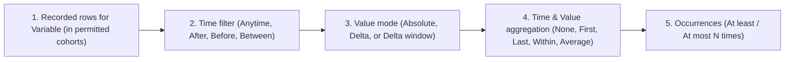

# Conditions, operators & advanced filters

Each **condition** (leaf card) in the Query Builder defines a rule over a single clinical concept. By default, a condition evaluates raw recorded observations; expanding **Advanced filters** adds longitudinal controls for date ranges, value changes over time, first/last or sliding-window selection, averaging, and event frequency.

## Evaluation order inside a single condition

Understanding the order in which a clinic evaluates a condition makes complex longitudinal rules easy to reason about:

1. **Variable resolution:** Select rows mapped to the chosen **Ontology + Data type** inside the cohorts you are allowed to query.
2. **Time filter:** Keep only observations whose visit timestamp falls inside the requested calendar window.
3. **Value mode:** Keep raw values (`Absolute`), compute consecutive visit-to-visit differences (`Delta`), or compute pairwise differences within a time span (`Delta` with interval).
4. **Time & Value aggregation:** Evaluate every item, pick only the `First` or `Last` item, compute an `Average`, or evaluate a sliding `Within` window.
5. **Occurrences:** Count how many distinct times the condition succeeded for the patient and apply `At least` / `At most` bounds.

---

## Main condition fields

### 1. Variable and Data type

- **Variable** is a searchable catalog selector pairing a semantic **Ontology** (for example *Heart rate*, *HbA1c*, *Diagnosis*) with a **Data type**.
- **Data type** (read-only) displays the underlying catalog type (`INT`, `FLOAT`, `STRING`, `BOOLEAN`, `DATE`, `DATE_TIME`, or `CATEGORICAL`). Hovering over it shows the full ontology name.
- Clinics only read local schema nodes mapped to that ontology and data type pair. If a clinic has no matching schema node in any cohort you are allowed to query, that clinic rejects the query with `Required condition cannot be found on this node`.

### 2. Operators by data type

The **Operator** dropdown automatically adapts to the selected variable's data type:

| Operator in UI | Wire spelling | Supported catalog types | Value required? | Behavior |
| --- | --- | --- | --- | --- |
| `Equals (=)` | `=` (alias `==`) | All | Yes | Exact match on the typed value. |
| `Not equal (!=)` | `!=` | All | Yes | Value is present (`NOT NULL`) and not equal to the target. |
| `Greater than (>)` / `After (>)` | `>` | `INT`, `FLOAT`, `STRING`, `DATE`, `DATE_TIME` | Yes | Strictly greater than (or chronologically after for dates). |
| `Greater than or equal (>=)` / `On or after (>=)` | `>=` | `INT`, `FLOAT`, `STRING`, `DATE`, `DATE_TIME` | Yes | Greater than or equal (or on/after for dates). |
| `Less than (<)` / `Before (<)` | `<` | `INT`, `FLOAT`, `STRING`, `DATE`, `DATE_TIME` | Yes | Strictly less than (or chronologically before for dates). |
| `Less than or equal (<=)` / `On or before (<=)` | `<=` | `INT`, `FLOAT`, `STRING`, `DATE`, `DATE_TIME` | Yes | Less than or equal (or on/before for dates). |
| `In (in)` | `in` | `INT`, `FLOAT`, `STRING`, `CATEGORICAL` | Yes (comma list) | Matches any value in a comma-separated list (e.g. `E10, E11`). |
| `Not in (!in)` | `!in` | `INT`, `FLOAT`, `STRING`, `CATEGORICAL` | Yes (comma list) | Value is present and not in the comma-separated list. |
| `Contains (contains)` | `contains` | `STRING`, `CATEGORICAL` | Yes | Case-insensitive substring match (`ILIKE '%value%'`). |
| `Starts with (startsWith)` | `startsWith` | `STRING`, `CATEGORICAL` | Yes | Case-insensitive prefix match (`ILIKE 'value%'`). |
| `Ends with (endsWith)` | `endsWith` | `STRING`, `CATEGORICAL` | Yes | Case-insensitive suffix match (`ILIKE '%value'`). |
| `Matches regex (regex)` | `regex` | `STRING`, `CATEGORICAL` | Yes | **Case-sensitive** PostgreSQL POSIX regular expression (`~`). |
| `Exists (exists)` | `exists` | All | No | At least one non-null value is recorded for the variable. |
| `Does not exist (!exists)` | `!exists` | All | No | Matches rows recorded for the schema node whose value column is `NULL` (see note below). |
| `Has changed (has_changed)` | `has_changed` | All | No | Value changed between visits (`current IS DISTINCT FROM previous`). Forces `Delta`. |
| `Changed from (changed_from)` | `changed_from` | All | Yes | Previous value equaled the target and the new value differs. Forces `Delta`. |
| `Changed to (changed_to)` | `changed_to` | All | Yes | New value equals the target and differs from the previous value. Forces `Delta`. |

:::note[`Does not exist (!exists)` vs. `Occurrences: At most 0`]
- **`Does not exist (!exists)`** checks whether a recorded row for that variable has an empty (`NULL`) value cell. If a clinic only stores rows when a measurement was actually taken, patients who never had the measurement have no row at all rather than a `NULL` row.
- To find **patients in the cohort who never matched a condition** (for example, *patients with no recorded Diagnosis = Sepsis*), use `Diagnosis = Sepsis` (or `Diagnosis exists`) and set **Advanced filters → At most** to `0`.
:::

:::warning[Unsupported text negation]
`!contains` (*not contains*) is intentionally rejected by both the UI validator and the clinic SQL compiler. To exclude patients whose text contains a substring, match `contains` and set **Occurrences → At most** to `0`.
:::

### 3. Value formats and validation

 clinics strictly validate every value against the local schema node's data type before executing SQL:

- **Whole numbers (`INT`):** Must be a valid integer (e.g. `42`, `-5`). Decimals such as `42.5` are rejected with `Integer comparison requires a whole number`.
- **Decimals (`FLOAT`):** Must be a plain number matching `-?\d+(\.\d+)?` (e.g. `7.2`, `-0.5`, `120`). Scientific notation is not accepted.
- **Booleans (`BOOLEAN`):** Dropdown with `true` or `false`.
- **Dates (`DATE`):** Must use ISO calendar format `YYYY-MM-DD` (e.g. `2025-05-15`).
- **Timestamps (`DATE_TIME`):** Accepts either a full ISO-8601 timestamp with offset (e.g. `2025-05-15T14:30:00Z`) or a date-only `YYYY-MM-DD` (interpreted as midnight UTC).
- **Lists (`in` / `!in`):** Enter comma-separated values such as `Stage I, Stage II, Stage III` (surrounding brackets `[...]` or quotes around items are stripped automatically; every item is validated against the column's data type).
- **Regular expressions (`regex`):** Only valid on `STRING` and `CATEGORICAL` variables. Before touching patient data, the clinic validates the pattern in an isolated PostgreSQL probe (`~` POSIX regex syntax). Invalid patterns such as an unclosed `(` fail immediately with `Regular expression is not valid`. Use `(?i)` at the start of the pattern (for example `(?i)^type\s*[12]`) when you want case-insensitive regex matching.

### 4. Datatype hint (numeric-in-string conversion)

Clinical source systems frequently import laboratory values into `STRING` or `CATEGORICAL` fields because occasional entries contain notes such as `"pending"`, `"cancelled"`, or `"below limit"`. Comparing those strings directly with `>` uses alphabetical order (where `"9" > "100"` is true!).

Setting **Datatype hint** solves this cleanly:

| Hint option | Effect |
| --- | --- |
| `Unset` (default) | Uses the schema node's native column type in `Absolute` mode. In `Delta` mode or with `Value aggregation = Average`, automatically defaults to `Float` numeric parsing. |
| `Integer` | Trims whitespace and parses values matching `^-?[0-9]+$` as numbers for magnitude comparisons (`=`, `!=`, `>`, `>=`, `<`, `<=`). Requires the comparison value itself to be a whole number. |
| `Float` | Trims whitespace and parses values matching `^-?[0-9]+(\.[0-9]+)?$` as decimal numbers for magnitude comparisons. |
| `String` / `Boolean` | Keeps the comparison value serialized as text/boolean in the wire payload rather than coercing numeric text to a JSON number. |

**Safety guarantee when parsing strings as numbers:**
- Rows whose text cannot be parsed as the requested number (such as `"N/A"` or `"pending"`) are **excluded** from the numeric comparison — they never fall back to alphabetical string comparison and never cause a runtime error.
- When a schema node is already `INT` or `FLOAT`, a numeric hint reads the typed numeric column first and falls back to parsing `value_string` only if the typed column is null.

### 5. Row actions

Every condition card has four quick actions on the right:
- **Move up / Move down** — reorders the condition within its group (any sibling [temporal relationships](groups-and-temporal-relations.md) automatically update their condition indexes).
- **Duplicate** — clones the condition card with all advanced settings.
- **Delete** — removes the condition (and removes any temporal relationship that pointed to it).

---

## Advanced filters

Click **Advanced filters** beneath a condition row to configure longitudinal behavior.

### 1. Value mode (`Absolute`, `Delta`, `Delta` within a window)

**Value mode** controls whether your operator tests a single measurement or the **change** between two measurements of the same patient and variable (ordered chronologically by `visit_timestamp, id`).

| Mode | Wire value | How it works |
| --- | --- | --- |
| **Absolute** | `"absolute"` | Tests each recorded observation value directly (default). |
| **Delta** | `"delta"` | Computes `current_value - previous_value` across **consecutive** observations of the patient, regardless of how much time passed between the two visits. |
| **Delta within a time window** | `"delta <interval>"` (e.g. `"delta 6 months"`) | Evaluates `later_value - earlier_value` across **any pair** of observations where `earlier < later <= earlier + interval` (even if intermediate visits occurred in between). |

Key rules for **Delta** modes:

- **Sign convention:** Because delta is `later - earlier`, **`> 10` means an increase of more than 10**, **`< -5` means a drop of more than 5** (`later - earlier < -5`), and **`< 0` means any decrease**.
- **Minimum observations:** A patient with fewer than two valid timestamped observations has no delta pair and will not match.
- **Numeric operators in Delta:** Numeric delta supports `=`, `!=`, `>`, `>=`, `<`, `<=` on `INT`, `FLOAT`, `STRING`, and `CATEGORICAL` variables (using `Float` parsing by default unless `Datatype hint: Integer` is selected).
- **Change operators (`has_changed`, `changed_from`, `changed_to`):** Work on **all** data types (including strings, booleans, dates, and categories) and automatically switch **Value mode** to `Delta`. Adding a delta interval (for example `delta 30 days`) checks whether any earlier/later pair within 30 days exhibits that transition.

### 2. Time filter (`Anytime`, `After`, `Before`, `Between`)

Restricts which observations are considered based on `visit_timestamp` (prior to computing deltas or aggregations):

- **Anytime** — all recorded timestamps are eligible.
- **After `YYYY-MM-DD`** — keeps observations strictly after midnight UTC of that date (`visit_timestamp > date 'YYYY-MM-DD'`). Note that an observation recorded with an exact date-only timestamp of `2025-05-01 00:00:00 UTC` is **excluded** by `After 2025-05-01`; choose `2025-04-30` if you want all of `2025-05-01` included.
- **Before `YYYY-MM-DD`** — keeps observations strictly before midnight UTC of that date (`visit_timestamp < date 'YYYY-MM-DD'`). Observations recorded during the day on `2025-05-31` (e.g. `2025-05-31 09:15 UTC`) are **after** `2025-05-31 00:00:00`, so use `Before 2025-06-01` to include the full day of May 31.
- **Between `YYYY-MM-DD` – `YYYY-MM-DD`** — applies both `After` and `Before` bounds simultaneously.

### 3. Time aggregation and 4. Value aggregation

**Time aggregation** selects *which* observations in the patient's filtered timeline are tested, while **Value aggregation** chooses whether to test individual values (**Any**) or their arithmetic mean (**Average**).

| Time aggregation | Value aggregation | Wire spelling | Clinical meaning |
| --- | --- | --- | --- |
| **None** | **Any** (`None`) | `"None"` / `"None"` | Patient matches if **any single** observation (or delta step) satisfies the operator. |
| **None** | **Average** | `"None"` / `"average"` | Computes `AVG(value)` across **all** filtered observations of the patient and tests whether that overall mean satisfies the operator (`Absolute` only). |
| **First** | **Any** (or **Average**) | `"first"` | Picks only the patient's **earliest** observation (or earliest delta step) and tests it against the operator. |
| **Last** | **Any** (or **Average**) | `"last"` | Picks only the patient's **most recent** observation (or latest delta step) and tests it against the operator. |
| **Within** *(Frequency: Any)* | **Average** *(required)* | `"within <interval>"` + `"average"` | Anchors a forward sliding window `[t, t + interval)` at each observation `t`. Matches if **any** window's `AVG(value)` satisfies the operator (`Absolute` only). |
| **Within** *(Frequency: At least N)* | **Any** (`None`) | `"within <interval> at least N times"` | Matches if there is at least one sliding window `[t, t + interval)` containing **N or more** observations that satisfy the operator (`Absolute` only, `N >= 1`). |
| **Within** *(Frequency: At most N)* | **Any** (`None`) | `"within <interval> at most N times"` | Among patients with at least one matching observation, requires that **every** sliding window `[t, t + interval)` contains **at most N** matching observations (`Absolute` only, `N >= 1`). |

**Interval builder:** Whenever a time window is active (`Delta` window or `Within` window), you can build single-unit or multi-part intervals using positive integers and `minutes`, `hours`, `days`, `weeks`, `months`, or `years` (for example `2 weeks` or `1 month 15 days` via **Add part**).

### 5. Occurrences (`At least` / `At most`)

**Occurrences** counts how many distinct times the entire condition (after time filtering, delta calculation, and aggregation) matched for a patient:

- **Both empty (default):** Requires at least 1 match.
- **At least `N` (`N >= 1`):** Patient must have `>= N` distinct matching occurrences (for example, *Blood pressure > 140 at least 3 times* across their history).
- **At least `0` with At most empty:** Matches every patient in the permitted cohort regardless of whether they had the event.
- **At most `M` (with At least empty or `0`):** Includes patients with **`0` up to `M`** matching occurrences. Setting **At most `0`** is the canonical way to express **exclusion criteria** (e.g. *exclude any patient with Diagnosis = Pregnancy*).
- **Both `At least N` and `At most M` (`0 <= N <= M`):** Patient's matching occurrence count must lie inclusively between `N` and `M`.

---

## Feature compatibility & UI auto-reset summary

To prevent invalid queries, the Query Builder automatically adjusts incompatible controls when you change an option, and the clinic compiler enforces the same rules if raw JSON is submitted directly:

| Selected feature | Allowed / enforced settings | Disallowed combinations |
| --- | --- | --- |
| `has_changed`, `changed_from`, `changed_to` | Forces `Value mode = Delta`, `Time aggregation = None`, `Value aggregation = Any` (`None`). | Cannot use `Absolute` mode, `First`/`Last`/`Within`, or `Average`. |
| `Value mode = Delta` (or `Delta <interval>`) | `Value aggregation = Any` (`None`); `Time aggregation` may be `None`, `First`, or `Last`. Numeric operators (`=`, `!=`, `>`, `>=`, `<`, `<=`) only. | Cannot combine with `Value aggregation = Average` or `Time aggregation = Within` (any variant), nor with text/list/existence operators. |
| `Time aggregation = Within` *(Frequency: Any)* | Automatically sets `Value aggregation = Average` and `Value mode = Absolute`. | Invalid without `Value aggregation = Average`. |
| `Time aggregation = Within, at least / at most N` | Forces `Value aggregation = Any` (`None`) and `Value mode = Absolute`; `N` must be a positive integer (`>= 1`). | Cannot combine with `Average` or `Delta`. |
| `Value aggregation = Average` | Requires `Value mode = Absolute` and a numeric-capable type (`INT`, `FLOAT`, `STRING`, or `CATEGORICAL`); `Time aggregation` may be `None`, `First`, `Last`, or `Within`. | Cannot be used on `BOOLEAN`, `DATE`, `DATE_TIME`, or `FILE`, and whole-series `Average` (`Time aggregation = None`) cannot be an endpoint of a [temporal relationship](groups-and-temporal-relations.md). |
| `scale` (Lang2Query paper field) | Not used in UI. | Rejected by the compiler (`scale is not supported yet`) — omit from JSON payloads. |

## Next steps

- Combine multiple conditions and order them across time in [**Groups & temporal relationships**](groups-and-temporal-relations.md).
- See concrete clinical examples and wire payloads in [**Results, privacy, JSON & troubleshooting**](results-privacy-and-json.md).
