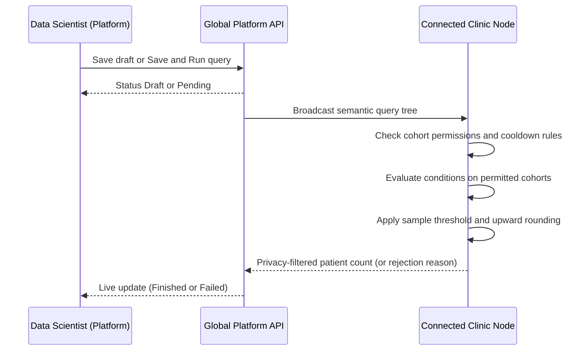

# Creating queries

A **query** defines a patient cohort across the %%DEPLOYED_PRODUCT_NAME%% network without moving or exposing raw patient records. You design the query once on the Platform using shared semantic variables; every connected clinic evaluates it locally against its own harmonized patient data, applies local governance and privacy rules, and returns only a privacy-filtered aggregate count.

This guide covers the **Query workspace**, the **Query Builder** workflow, query versioning, and how to move from a cohort count to cross-clinic statistics or a federated analysis project.

## How federated querying works

Key design principles to keep in mind:

- **Semantic, not column-bound:** Queries reference shared **ontology** and **data type** pairs (for example *Age · Integer* or *Diagnosis · String*), never clinic-specific CSV headers or database table names.
- **Automatic clinic evaluation:** Discovery queries do not wait for manual approval in a clinic's inbox. Each clinic evaluates them automatically against its configured access permissions, rate limits, and privacy thresholds.
- **Single-cohort per query:** Each query defines one target cohort. When a study compares two populations (such as a *case* cohort and a *control* cohort), create and run two separate queries so each cohort keeps its own version history, count, and statistics profile.

## Where to start

1. Log in to the Platform and open **Find Data** in the main navigation. This opens the **Query workspace**.
2. Click **Add Query** (or **Add Query** on the empty-state screen if you have none yet).
3. Enter:
   - **Name of the query** — a clear label shown in your workspace and project selectors (for example, `Type 2 Diabetes - Adults >= 40`).
   - **Description** — the clinical intent, inclusion criteria, or study context.
4. Build your condition tree in the **Query Builder**, then click:
   - **Create** (or **Save**) to store an unfired **Draft**, or
   - **Send Request to All Clinics** (**Save and run query**) to save and immediately broadcast the query to all connected clinics.

## The building blocks

Every query is a hierarchical tree of **groups** and **conditions**:

- **Condition (leaf):** Matches patient observations for a specific **Variable** (*ontology + data type*) using a datatype-aware **Operator** (`=`, `!=`, `>`, `>=`, `<`, `<=`, `in`, `not in`, `contains`, `starts with`, `ends with`, `regex`, `exists`, `not exists`, `has changed`, `changed from`, `changed to`), an optional **Value**, and an optional **Datatype hint** when numeric or boolean values are stored as text.
- **Advanced filters (per condition):** Narrow *how* longitudinal observations are evaluated:
  - **Value mode** — compare `Absolute` recorded values, consecutive changes (`Delta`), or changes within a time span (`Delta` with an interval).
  - **Time filter** — restrict observations to `Anytime`, `After`, `Before`, or `Between` calendar dates.
  - **Time aggregation** — evaluate `None` (all matching observations), only the `First` or `Last` observation, or a sliding time window (`Within`).
  - **Value aggregation** — match `Any` single observation or compare the `Average` across observations.
  - **Occurrences (`At least` / `At most`)** — require the condition to hold a minimum or maximum number of times for a patient (including `At most 0` to exclude matching patients).
- **Group (`AND` / `OR`):** Combines conditions and nested sub-groups with **AND** (*Match all*) or **OR** (*Match any*). Groups can be nested to any depth, reordered, duplicated, or collapsed into a compact text summary.
- **Temporal relationship:** Links two sibling conditions inside the same group so their events must occur in the `Same group`, `Same visit`, `Same time` (same UTC day), `Within` an interval, `In the following` interval, or `Anytime after` one another — optionally bounded by `At least` / `At most` occurrences.

Explore each part in detail in the companion pages of this guide:

1. [**Conditions, operators & advanced filters**](conditions-and-filters.md) — every variable input, operator, datatype hint, longitudinal value mode, time window, aggregation, and compatibility rule.
2. [**Groups & temporal relationships**](groups-and-temporal-relations.md) — combining conditions with `AND` / `OR`, nesting sub-groups, and constraining event order or visit grouping.
3. [**Results, privacy, JSON & troubleshooting**](results-privacy-and-json.md) — status badges, clinic privacy rounding, requesting cross-clinic statistics, `Show JSON` format, end-to-end clinical recipes, and error resolution.

## Navigating the Query workspace

The **Query workspace** (`Find Data`) lists only queries owned by your account and always shows the **latest version** of each query group.

| Column / Control | Purpose |
| --- | --- |
| **Search queries** | Filters your list by name, description, result count, or readable query expression. |
| **Name** | Opens the full **Query detail** page (`/find-data/{id}`). |
| **Query string** | Compact human-readable summary of the condition tree (for example `Age > 35 AND Heart rate > 70`). |
| **Updated at** | Timestamp of the latest version in the group. |
| **Status** | Current lifecycle badge: **Draft** (gray), **Pending** (pulsing blue), **Finished** (green), or **Failed** (red). |
| **Result** | Aggregated, privacy-rounded patient count across responding clinics (`—` while unfired or pending). |
| **Actions** | For unfired drafts (`⋮` menu): **Edit**, **Run query**, **Delete**, or **Go to project**. For fired queries: quick **Edit** action to create or run a new version. |

## Working on the Query detail page

Clicking a query's name opens its dedicated detail view with up to four tabs:

| Tab | When shown | What you can do |
| --- | --- | --- |
| **Overview** | Always | Inspect the query status badge, creation timestamp, aggregated patient count, latest statistics request timestamp, and a structured outline of all groups, conditions, and temporal relationships. |
| **Query Builder** | Always | Edit the name, description, and condition tree; toggle **Show JSON** to inspect or copy the exact wire request; click **Save** to store a draft version or **Send Request to All Clinics** to save and broadcast immediately. |
| **Versions** | When earlier versions exist | Browse a read-only chronological timeline of prior versions in the same query group, keeping each earlier run's exact condition outline, status, and patient count intact. |
| **Statistics** | After requesting statistics (or once fired) | Request and inspect privacy-filtered cross-clinic property distributions for the matching patient cohort. |

:::tip[Inspecting the wire payload]
Inside the **Query Builder** (both in the creation dialog and on the detail page), click **Show JSON** to view and copy the live request payload sent to the server. See [JSON wire format reference](results-privacy-and-json.md#show-json-and-wire-format-reference) for every field.
:::

## Saving, editing, versioning, and deleting

Queries are part of the platform's audit trail, so fired executions are never overwritten in place. Instead, versions are linked together under a shared `groupId`:

- **Save a new draft (`Create`):** Persists the query in **Draft** state without contacting clinics.
- **Edit a query (`Save`):** Saves a new draft version in the same query group. Your workspace list automatically points to this newest version, while previous runs remain preserved under the **Versions** tab.
- **Run an unfired draft (`Run query`):** Broadcasts the existing draft directly and transitions it to **Pending**.
- **Save & run or re-run an already-fired query (`Send Request to All Clinics`):** Creates a fresh version in the same group with a new unique execution ID and broadcasts it immediately, keeping earlier counts attached to the historical version that produced them.
- **Delete a query:** Available **only** when the query belongs to you, has **not** been fired (`Draft`), has no result, and is not linked to a project. Once a query has been fired to clinics, it cannot be deleted.

## Next steps

- Learn every leaf control and longitudinal rule in [**Conditions, operators & advanced filters**](conditions-and-filters.md).
- Link events across visits and time windows in [**Groups & temporal relationships**](groups-and-temporal-relations.md).
- Review privacy behavior, clinical recipes, and error messages in [**Results, privacy, JSON & troubleshooting**](results-privacy-and-json.md).
- Once your cohort is ready, turn it into an analysis in [**Use found data for federated data analysis**](../../create-fl-project.md) or walk through screenshots in [**Walkthrough: Create a Query**](../../../tutorials/walkthroughs/wt-query.md).
