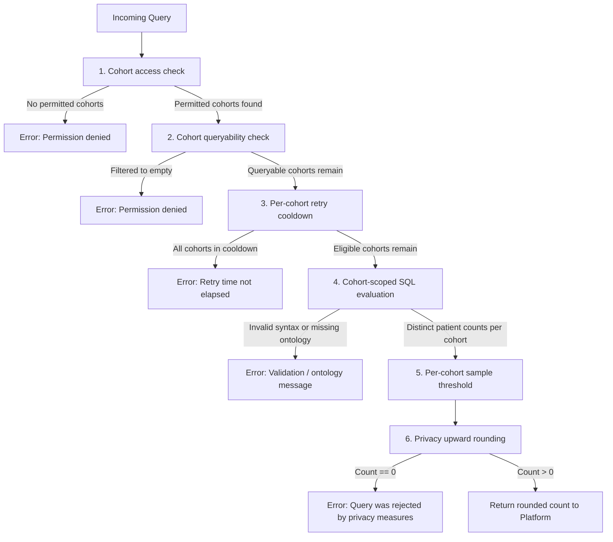

# Results, privacy, JSON & troubleshooting

Once you click **Send Request to All Clinics**, your query is broadcast over WebSockets to every connected clinic node. Clinics evaluate the query independently and asynchronously, enforce local permissions and privacy rules, and stream aggregated counts back to the Platform in real time.

---

## Query statuses and live updates

You do not need to refresh the browser after running a query — the Platform subscribes to live Server-Sent Events (`/query/sse`) for the latest version of each query group and updates badges and counts automatically as clinic replies arrive.

| Badge | Color | Meaning |
| --- | --- | --- |
| **Draft** | Gray | Saved on the Platform (`hasFired = false`), not yet sent to any clinic. Can still be edited, run, or deleted. |
| **Pending** | Pulsing Blue | Broadcast to connected clinics (`hasFired = true`), awaiting the first clinic reply (`hasResult = false` and no error recorded yet). |
| **Finished** | Green | At least one clinic response has been processed (`hasResult = true` with a numeric `result`). If additional clinics respond slightly later, the count continues to accumulate as their replies arrive. |
| **Failed** | Red | An execution error occurred without a valid numeric patient count (`error` present without a resolved count). |

:::note[Why a query can stay `Pending` or finish with `0`]
- **Stays `Pending`:** The global server does not assume a fixed number of clinics. If zero clinic nodes are currently connected, or clinics are still running a heavy longitudinal query (up to the local query timeout, 120 seconds by default), the query remains **Pending** until the first clinic responds.
- **Finishes with `0 patients`:** When a clinic rejects a query (for example due to permissions, a missing ontology in permitted cohorts, or privacy suppression), its contributed count is `0`. If *every* responding clinic contributes `0`, the aggregated total settles at `0`.
:::

---

## How each clinic evaluates and protects patient data

Every clinic node runs a strict six-stage governance and privacy pipeline before any number leaves the hospital network:



1. **Cohort access permissions:** Checks which local cohorts your account is permitted to query in the clinic's Access Management settings.
2. **Cohort queryability:** Verifies that those cohorts allow querying for the requested ontology leaves. If none remain, the clinic returns `Permission denied` without touching patient data.
3. **Query frequency limit (cooldown):** Cohorts with a configured minimum time between queries are temporarily skipped if queried too recently. If *all* permitted cohorts are still in cooldown, the clinic asks you to wait before retrying.
4. **Cohort-scoped compilation and counting:** Both schema-node resolution and patient counting (`patient_meta`) are restricted strictly to your permitted, queryable cohorts. Other cohorts on the same clinic node are invisible to the query.
5. **Per-cohort minimum sample threshold:** Any cohort whose matching patient count falls below its configured `querySampleThreshold` is dropped (`0`).
6. **Upward privacy rounding:** Surviving cohort counts are summed and rounded upward (by default, totals below the clinic's minimum query threshold — typically `100` — are suppressed to `0`, and larger totals are rounded up). If the final privacy-adjusted count is `0`, the clinic rejects the response as `Query was rejected by privacy measures`.

:::warning[Counts are privacy-protected estimates, not exact row counts]
Because small cohorts are suppressed per cohort and surviving counts are rounded upward at each clinic before summation across clinics, treat returned numbers as conservative feasibility estimates rather than exact database row counts.
:::

### Per-clinic visibility and TRE mode

In standard federated mode, individual clinic names, per-clinic breakdowns, and hardware details are hidden — you see the aggregated patient count across clinics. Per-system metadata (`/query/{id}/systems`) is exposed **only** by clinics that explicitly enable Trusted Research Environment (`TRE`) execution and opt in to sharing their name.

---

## Using a query for Statistics and Federated Projects

A fired query is the foundation for downstream steps in %%DEPLOYED_PRODUCT_NAME%%:

1. **Cross-clinic Statistics:**
   - Open a fired query's detail page and click **Send Request to All Clinics** (**Request Statistics**) in the header (or inside the **Statistics** tab).
   - Clinics compute sanitized distribution profiles (with rare categories removed, extremes stripped, and counts rounded) over the patients matched by your query.
   - Switch to the **Statistics** tab to compare variable coverage and distributions across responding clinics before starting model training.
2. **Federated Analysis & Training Projects:**
   - When you attach a query to a [federated analysis project](../../create-fl-project.md), participating clinics (after local request approval, where required) run the exact same cohort-scoped query logic locally to select the training or analysis patient subset.

---

## Step-by-step clinical recipes

Each recipe below shows the **Query Builder UI steps** alongside the equivalent **Lang2Query JSON** (visible via **Show JSON**).

### Recipe 1: Adults over 35 with elevated heart rate in May 2025

1. Keep the root group set to **AND** (*Match all*).
2. Condition `1`: Variable *Age*, Operator `Greater than (>)`, Value `35`.
3. Click **+ Condition** to add Condition `2`: Variable *Heart rate*, Operator `Greater than (>)`, Value `70`.
4. On Condition `2`, click **Advanced filters** → **Time filter** → **Between**, and set `2025-04-30` to `2025-06-01` (remember date bounds are exclusive of midnight UTC).
5. Click **Send Request to All Clinics**.

<details>
<summary>Show JSON payload</summary>

```json
{
  "name": "Elevated HR in May 2025",
  "description": "Patients over 35 with heart rate > 70 during May 2025",
  "query": {
    "connecting_operator": "$and",
    "conditions": [
      {
        "ontology_id": "<age-ontology-id>",
        "data_type_id": "<int-datatype-id>",
        "operator": ">",
        "value": 35,
        "value_mode": "absolute",
        "time_aggregation_method": "None",
        "value_aggregation_method": "None"
      },
      {
        "ontology_id": "<heart-rate-ontology-id>",
        "data_type_id": "<int-datatype-id>",
        "operator": ">",
        "value": 70,
        "value_mode": "absolute",
        "time_filter": {
          "after": "2025-04-30",
          "before": "2025-06-01"
        },
        "time_aggregation_method": "None",
        "value_aggregation_method": "None"
      }
    ]
  }
}
```

</details>

### Recipe 2: Rapid HbA1c rise of at least +1.0 within 6 months (stored as text)

Use **Datatype hint** + **Delta within a time window** when a lab measurement is stored in a string field:

1. Select Variable *HbA1c* (even if its **Data type** is `STRING`), Operator `Greater than or equal (>=)`, Value `1.0`, **Datatype hint** `Float`.
2. Open **Advanced filters** → **Value mode** → select **Delta within a time window** and set the interval to `6` `months`.
3. Save and run. Unparseable text rows (such as `"pending"`) are ignored automatically, and any pair of readings at most 6 months apart with `later - earlier >= 1.0` matches.

<details>
<summary>Show JSON payload</summary>

```json
{
  "ontology_id": "<hba1c-ontology-id>",
  "data_type_id": "<string-datatype-id>",
  "datatype": "Float",
  "operator": ">=",
  "value": 1,
  "value_mode": "delta 6 months",
  "time_aggregation_method": "None",
  "value_aggregation_method": "None"
}
```

</details>

### Recipe 3: Frequent high systolic BP (`>= 3` readings within any 30-day window)

1. Select Variable *Systolic blood pressure*, Operator `Greater than (>)`, Value `140`.
2. Open **Advanced filters** → **Time aggregation** → click **Within**.
3. Set the interval to `30` `days`, choose frequency **At least**, and enter `3` `time(s)`.

<details>
<summary>Show JSON payload</summary>

```json
{
  "ontology_id": "<sbp-ontology-id>",
  "data_type_id": "<int-datatype-id>",
  "operator": ">",
  "value": 140,
  "value_mode": "absolute",
  "time_aggregation_method": "within 30 days at least 3 times",
  "value_aggregation_method": "None"
}
```

</details>

### Recipe 4: Glucose spike within 2 weeks *after* an elevated HbA1c

1. Root group **AND**:
   - Condition `1`: *HbA1c* `>` `7`.
   - Condition `2`: *Blood glucose* `>` `180`.
2. Click **+ Temporal relationship** in the group header:
   - **Source:** `1` (*HbA1c*)
   - **Relationship:** **In the following**
   - **Interval:** `2` `weeks`
   - **Target:** `2` (*Blood glucose*)

<details>
<summary>Show JSON payload</summary>

```json
{
  "connecting_operator": "$and",
  "conditions": [
    {
      "ontology_id": "<hba1c-ontology-id>",
      "data_type_id": "<float-datatype-id>",
      "operator": ">",
      "value": 7,
      "value_mode": "absolute",
      "time_aggregation_method": "None",
      "value_aggregation_method": "None"
    },
    {
      "ontology_id": "<glucose-ontology-id>",
      "data_type_id": "<float-datatype-id>",
      "operator": ">",
      "value": 180,
      "value_mode": "absolute",
      "time_aggregation_method": "None",
      "value_aggregation_method": "None"
    }
  ],
  "temporal_relations": [
    {
      "source_condition": 0,
      "target_condition": 1,
      "relationship": "in the following 2 weeks"
    }
  ]
}
```

</details>

### Recipe 5: Inclusion with an exclusion criterion (`At most 0`)

To select *patients with Type 2 Diabetes (`E11`) who have never had Chronic Kidney Disease (`N18`)*:

1. Root group **AND**:
   - Condition `1`: *Diagnosis* `=` `E11`.
   - Condition `2`: *Diagnosis* `startsWith` `N18`, **Advanced filters → At most** `0`.

<details>
<summary>Show JSON payload</summary>

```json
{
  "connecting_operator": "$and",
  "conditions": [
    {
      "ontology_id": "<diagnosis-ontology-id>",
      "data_type_id": "<string-datatype-id>",
      "operator": "=",
      "value": "E11",
      "value_mode": "absolute",
      "time_aggregation_method": "None",
      "value_aggregation_method": "None"
    },
    {
      "ontology_id": "<diagnosis-ontology-id>",
      "data_type_id": "<string-datatype-id>",
      "operator": "startsWith",
      "value": "N18",
      "value_mode": "absolute",
      "time_aggregation_method": "None",
      "value_aggregation_method": "None",
      "at_most": 0
    }
  ]
}
```

</details>

---

## Show JSON and wire format reference

Clicking **Show JSON** displays the exact `QueryCreateDTO` / `QueryDTO` body sent to `POST /query`, `PUT /query/{id}`, or `POST /query/fire`.

### Group node (`Lang2Group`)

| Field | Type | Required | Description |
| --- | --- | --- | --- |
| `connecting_operator` | `"$and"` \| `"$or"` | Yes | Combines child nodes via SQL `INTERSECT` (`$and`) or `UNION` (`$or`). |
| `conditions` | `Array<Group \| Leaf>` | Yes (non-empty) | Ordered child conditions and/or nested groups. |
| `temporal_relations` | `Array<TemporalRelation>` | Optional | Correlates leaf conditions in `conditions` using zero-based indexes (`0` appears as badge `1` in the UI). |

### Leaf condition node (`Lang2Leaf`)

| Field | Type | Default / Required | Accepted values |
| --- | --- | --- | --- |
| `ontology_id` | `string` | Required (set by UI) | UUID or identifier of the target ontology concept. |
| `data_type_id` | `string` | Required (set by UI) | UUID or identifier of the target data type node. |
| `operator` | `string` | Required | `=`, `!=`, `>`, `>=`, `<`, `<=`, `in`, `!in`, `contains`, `startsWith`, `endsWith`, `regex`, `exists`, `!exists`, `has_changed`, `changed_from`, `changed_to`. |
| `value` | `string \| number \| boolean` | Required unless `exists`, `!exists`, `has_changed` | Comparison target (comma-separated string for `in` / `!in`). |
| `datatype` | `string` | Optional | `"String"`, `"Integer"`, `"Float"`, or `"Boolean"`. |
| `value_mode` | `string` | `"absolute"` | `"absolute"`, `"delta"`, or `"delta <interval>"`. |
| `time_filter` | `"anytime"` \| `object` | Omitted (`anytime`) | `{ "after": "YYYY-MM-DD", "before": "YYYY-MM-DD" }` (either or both keys). |
| `time_aggregation_method` | `string` | `"None"` | `"None"`, `"first"`, `"last"`, `"within <interval>"`, `"within <interval> at least <N> times"`, `"within <interval> at most <N> times"`. |
| `value_aggregation_method` | `string` | `"None"` | `"None"` or `"average"`. |
| `at_least` | `integer` (`>= 0`) | Optional | Minimum distinct matching occurrences per patient. |
| `at_most` | `integer` (`>= 0`) | Optional | Maximum distinct matching occurrences per patient (`at_least <= at_most`). |

### Temporal relation object (`TemporalRelationDTO`)

| Field | Type | Required | Description |
| --- | --- | --- | --- |
| `source_condition` | `integer` | Yes | Zero-based index of the source leaf in the parent group's `conditions` array. |
| `target_condition` | `integer` | Yes | Zero-based index of the target leaf (`source_condition != target_condition`). |
| `relationship` | `string` | Yes | `"same group"`, `"same visit"`, `"same time"`, `"within <interval>"`, `"in the following <interval>"`, or `"anytime after"`. |
| `at_least` | `integer` (`>= 0`) | Optional | Minimum matching target occurrences for at least one source occurrence (defaults to `1` when `at_most` is omitted, or `0` when `at_most` is set). |
| `at_most` | `integer` (`>= 0`) | Optional | Universal cap on matching target occurrences per source occurrence. |

---

## Troubleshooting & error messages

| Visible message or symptom | What caused it | How to resolve it |
| --- | --- | --- |
| **`Permission denied`** | Your account has no query permission on any cohort at that clinic, or none of your permitted cohorts allow querying the variables in your query. | Contact the project coordinator or the clinic's Data Access Manager to verify cohort permissions and ontology queryability. |
| **`Query retry time not elapsed for all permitted cohorts. Please wait before retrying.`** | Every permitted cohort at that clinic enforces a minimum cooldown interval between queries and was queried recently by your account. | Wait for the clinic's retry window to expire before re-running. |
| **`Required condition cannot be found on this node`** | At least one required condition references an `ontology_id` / `data_type_id` pair that is not mapped in any of your permitted cohorts at that clinic. | Check whether the clinic harmonized that concept under a different data type, or wrap optional site-specific alternatives in an **OR** group if appropriate. |
| **`Query was rejected by privacy measures`** | The query succeeded technically, but after dropping cohorts below `querySampleThreshold` and applying `PrivacyBO` minimum-count suppression, the releasable count was `0`. | Broaden overly narrow filters (such as tight date windows or rare combinations) so cohorts meet the clinic's minimum sample size. |
| **`Regular expression is not valid`** | The `regex` value is blank or rejected by PostgreSQL's POSIX regular expression parser (for example an unmatched `[` or `(`). | Fix the regex syntax and escape literal parentheses or brackets (`\(` / `\[`). |
| **`Regular expression requires a text value`** | `regex` was applied to a non-text variable (`INT`, `FLOAT`, `BOOLEAN`, `DATE`, `DATE_TIME`). | Switch to `=`, `in`, or range operators for typed columns. |
| **`Integer comparison requires a whole number`** / **`Numeric comparison requires a number`** | The value entered for an `INT` / `FLOAT` variable (or numeric `Datatype hint` / `Delta`) is not a valid integer or plain decimal. | Enter a plain integer (e.g. `42`) or decimal (e.g. `7.5`) without units or symbols. |
| **`Query could not be evaluated`** | An unexpected runtime or database failure (such as a local query timeout) occurred on the clinic node. Detailed stack traces stay inside clinic logs to protect local data privacy. | Simplify heavy multi-window joins or scope the query with a **Time filter**, or ask the clinic administrator to inspect local logs. |
| **Save / Run buttons are disabled (`Complete the query or remove the invalid combination before saving.`)** | A condition is missing a variable, operator, required value, valid `YYYY-MM-DD` date, positive interval, or has `At least > At most`. | Check each condition card and temporal relationship banner for empty fields or inverted bounds. |
| **Status stays `Pending` indefinitely** | No clinic nodes were connected when the query was broadcast, or connected nodes went offline before replying. | Re-run the query once participating clinics are online. |
| **Editing a query did not delete the old result** | By design, saving or re-running creates a new version in the same `groupId`. | Open the **Versions** tab on the detail page to inspect earlier runs; the workspace list always shows the latest version. |

---

## See also

- [Creating queries — overview & workspace](index.md)
- [Conditions, operators & advanced filters](conditions-and-filters.md)
- [Groups & temporal relationships](groups-and-temporal-relations.md)
- [Use found data for federated data analysis](../../create-fl-project.md)
- Contributor internals:
  - [Global learning API · Query creation & broadcasting](../../../contribution-guide/backend/global-learning-api/query-creation.md)
  - [Local learning API · Query translation & privacy](../../../contribution-guide/backend/local-learning-api/query-translation-and-privacy.md)
  - [Frontend · Query system](../../../contribution-guide/frontend/systems/query-system.md)
